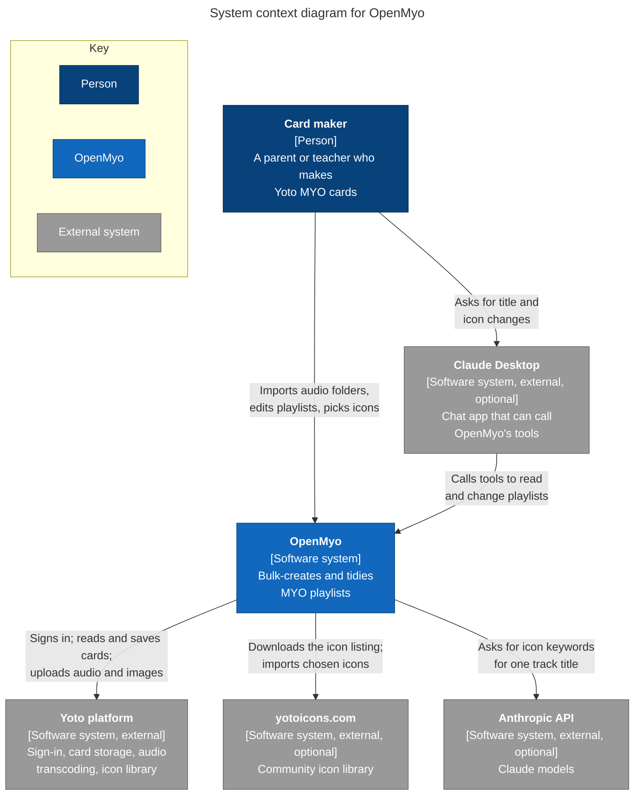
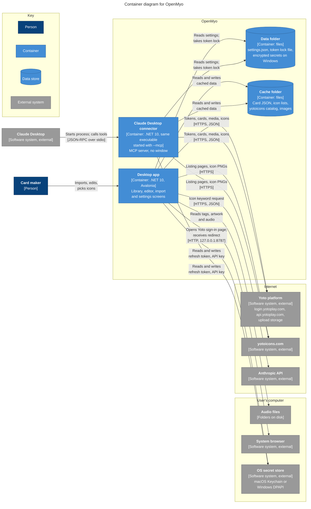

# Architecture

## Bird's eye view

OpenMyo is a desktop app for macOS and Windows that manages Yoto "Make Your Own" (MYO) playlists. It
turns folders of audio files into playlists on the user's Yoto account, and tidies existing playlists:
titles, track order, covers and the 16×16 pixel icon shown for each track.

OpenMyo has no server and keeps no playlists of its own. Every playlist lives on Yoto as a JSON document
called a **card**. OpenMyo reads cards, changes them, and saves them back through Yoto's public API. Local
files are settings and caches only.

Most of the interesting logic is local and offline: grouping and ordering files, cleaning titles, and
matching each title to an icon with trigram similarity. Claude is an optional extra in two places: the
user can ask Claude for icon keywords in the icon picker, and Claude Desktop can drive OpenMyo through
the Model Context Protocol (MCP).

## System context



## Containers



The desktop app and the connector are the same executable ([`Program`](../src/OpenMyo.App/Program.cs)
chooses the mode from the `--mcp` argument) and build the same services. They can run at the same time.
They never talk to each other directly; they share the secret store, the data and cache folders, and a
lock file that stops both refreshing the Yoto token at once.

All communication is request and response. The one slow step is on Yoto's side: after an upload, Yoto
transcodes the audio in the background and OpenMyo polls until it is done.

| Data | Location |
|---|---|
| Data folder | `~/Library/Application Support/OpenMyo` (macOS), `%LOCALAPPDATA%\OpenMyo` (Windows) |
| Cache folder | `~/Library/Caches/OpenMyo` (macOS), `%LOCALAPPDATA%\OpenMyo\Cache` (Windows); safe to delete |

## Code map

The solution is layered. `OpenMyo.Core` holds the domain and the algorithms; every other project either
implements a Core interface or uses Core.

```text
App ──► Core, Yoto, Claude, Mcp, Infrastructure
Yoto, Claude, Mcp, Infrastructure ──► Core
Core ──► nothing in the solution
```

Folders are organised by feature, not by type, and a feature keeps the same folder name in every project
that has it: `Icons` exists in Core, Yoto and Mcp. The App groups its folders by screen instead (see
[`OpenMyo.App`](#openmyoapp)).

### [`OpenMyo.Core`](../src/OpenMyo.Core)

- [`Playlists/`](../src/OpenMyo.Core/Playlists): the domain records [`Playlist`](../src/OpenMyo.Core/Playlists/Playlist.cs), [`Chapter`](../src/OpenMyo.Core/Playlists/Chapter.cs), [`Track`](../src/OpenMyo.Core/Playlists/Track.cs) and [`PlaylistSummary`](../src/OpenMyo.Core/Playlists/PlaylistSummary.cs). All immutable.
- [`Abstractions/`](../src/OpenMyo.Core/Abstractions): the interfaces outer projects implement, such as [`IPlaylistRepository`](../src/OpenMyo.Core/Abstractions/IPlaylistRepository.cs),
  [`IMediaUploader`](../src/OpenMyo.Core/Abstractions/IMediaUploader.cs), [`IIconCatalog`](../src/OpenMyo.Core/Abstractions/IIconCatalog.cs), [`ISecretStore`](../src/OpenMyo.Core/Abstractions/ISecretStore.cs), [`ISettingsStore`](../src/OpenMyo.Core/Abstractions/ISettingsStore.cs) and [`IYotoSession`](../src/OpenMyo.Core/Abstractions/IYotoSession.cs).
- [`Import/`](../src/OpenMyo.Core/Import): files to playlist drafts. [`ImportGrouper`](../src/OpenMyo.Core/Import/ImportGrouper.cs) decides which files form a playlist,
  [`TrackOrderer`](../src/OpenMyo.Core/Import/TrackOrderer.cs) orders them, [`ArtworkLocator`](../src/OpenMyo.Core/Import/ArtworkLocator.cs) finds covers and icon art, [`DraftBuilder`](../src/OpenMyo.Core/Import/DraftBuilder.cs) runs the steps.
- [`Feeds/`](../src/OpenMyo.Core/Feeds): podcast RSS import. [`FeedParser`](../src/OpenMyo.Core/Feeds/FeedParser.cs) reads a feed for preview,
  [`FeedImporter`](../src/OpenMyo.Core/Feeds/FeedImporter.cs) downloads the chosen episodes and artwork through [`IFeedClient`](../src/OpenMyo.Core/Abstractions/IFeedClient.cs) into a temporary cache folder and returns a `PlaylistDraft`.
- [`Text/`](../src/OpenMyo.Core/Text): text rules shared by import and icon matching. [`TitleCleaner`](../src/OpenMyo.Core/Text/TitleCleaner.cs), [`TextNormalizer`](../src/OpenMyo.Core/Text/TextNormalizer.cs),
  [`Trigrams`](../src/OpenMyo.Core/Text/Trigrams.cs), [`IconQuery`](../src/OpenMyo.Core/Text/IconQuery.cs), and the word lists [`Synonyms.txt`](../src/OpenMyo.Core/Text/Synonyms.txt) and [`WeakWords.txt`](../src/OpenMyo.Core/Text/WeakWords.txt).
- [`Icons/`](../src/OpenMyo.Core/Icons): icon matching. [`IconIndex`](../src/OpenMyo.Core/Icons/IconIndex.cs) and [`IconScorer`](../src/OpenMyo.Core/Icons/IconScorer.cs) search and score, [`IconIndexProvider`](../src/OpenMyo.Core/Icons/IconIndexProvider.cs) builds the
  shared index, [`IconSuggester`](../src/OpenMyo.Core/Icons/IconSuggester.cs) and [`IconAutoAssigner`](../src/OpenMyo.Core/Icons/IconAutoAssigner.cs) pick icons, [`NumberIconMaker`](../src/OpenMyo.Core/Icons/NumberIconMaker.cs) draws number icons,
  [`AiIconSearch`](../src/OpenMyo.Core/Icons/AiIconSearch.cs) adds Claude keywords.
- [`CommunityIcons/`](../src/OpenMyo.Core/CommunityIcons): an offline copy of yotoicons.com. [`CommunityCatalogHarvester`](../src/OpenMyo.Core/CommunityIcons/CommunityCatalogHarvester.cs) downloads it,
  [`CommunityCatalogProvider`](../src/OpenMyo.Core/CommunityIcons/CommunityCatalogProvider.cs) caches it, [`CommunityIconImporter`](../src/OpenMyo.Core/CommunityIcons/CommunityIconImporter.cs) copies a chosen icon to the user's account.
- [`Publishing/`](../src/OpenMyo.Core/Publishing): [`PlaylistPublisher`](../src/OpenMyo.Core/Publishing/PlaylistPublisher.cs) uploads media and creates or extends playlists.
- [`Playback/`](../src/OpenMyo.Core/Playback): [`PlaybackLists`](../src/OpenMyo.Core/Playback/PlaybackLists.cs) turns a playlist (with signed stream URLs) or an import draft into a
  [`PlaybackList`](../src/OpenMyo.Core/Playback/PlaybackList.cs) for the player bar; the engine sits behind [`IAudioPlayer`](../src/OpenMyo.Core/Abstractions/IAudioPlayer.cs).
- [`Library/`](../src/OpenMyo.Core/Library): [`PlaylistHealth`](../src/OpenMyo.Core/Library/PlaylistHealth.cs) flags playlists with no tracks, missing icons or no cover.

### [`OpenMyo.Yoto`](../src/OpenMyo.Yoto)

- [`Http/`](../src/OpenMyo.Yoto/Http): named `HttpClient`s and [`RetryHandler`](../src/OpenMyo.Yoto/Http/RetryHandler.cs).
- [`Auth/`](../src/OpenMyo.Yoto/Auth): sign-in and tokens. [`YotoSession`](../src/OpenMyo.Yoto/Auth/YotoSession.cs) owns the tokens, [`LoopbackAuthorizer`](../src/OpenMyo.Yoto/Auth/LoopbackAuthorizer.cs) catches the browser
  redirect, [`YotoAuthHandler`](../src/OpenMyo.Yoto/Auth/YotoAuthHandler.cs) adds the bearer token, [`RefreshLock`](../src/OpenMyo.Yoto/Auth/RefreshLock.cs) serialises refreshes across processes.
- [`Content/`](../src/OpenMyo.Yoto/Content): cards. [`YotoPlaylistRepository`](../src/OpenMyo.Yoto/Content/YotoPlaylistRepository.cs) implements [`IPlaylistRepository`](../src/OpenMyo.Core/Abstractions/IPlaylistRepository.cs), [`CardMapper`](../src/OpenMyo.Yoto/Content/CardMapper.cs) reads card
  JSON, [`CardComposer`](../src/OpenMyo.Yoto/Content/CardComposer.cs) and [`ChapterComposer`](../src/OpenMyo.Yoto/Content/ChapterComposer.cs) write it, [`CardCache`](../src/OpenMyo.Yoto/Content/CardCache.cs) keeps the last copy of each card,
  [`YotoTrackStreams`](../src/OpenMyo.Yoto/Content/YotoTrackStreams.cs) asks for signed, playable track URLs (`playable=true&signingType=s3`) and never caches them.
- [`Media/`](../src/OpenMyo.Yoto/Media): [`YotoMediaUploader`](../src/OpenMyo.Yoto/Media/YotoMediaUploader.cs) uploads audio, covers and icons.
- [`Icons/`](../src/OpenMyo.Yoto/Icons): [`YotoIconCatalog`](../src/OpenMyo.Yoto/Icons/YotoIconCatalog.cs) lists Yoto's public icons and the user's own.
- [`CommunityIcons/`](../src/OpenMyo.Yoto/CommunityIcons): [`YotoIconsClient`](../src/OpenMyo.Yoto/CommunityIcons/YotoIconsClient.cs) reads yotoicons.com.
- [`Json/`](../src/OpenMyo.Yoto/Json): response DTOs and the source-generated [`YotoJsonContext`](../src/OpenMyo.Yoto/Json/YotoJsonContext.cs).

### [`OpenMyo.Claude`](../src/OpenMyo.Claude)

[`ClaudeKeywordGenerator`](../src/OpenMyo.Claude/ClaudeKeywordGenerator.cs) implements [`IIconKeywordGenerator`](../src/OpenMyo.Core/Icons/IIconKeywordGenerator.cs): one track title in, a few icon keywords out.
[`KeywordPrompt`](../src/OpenMyo.Claude/KeywordPrompt.cs) holds the prompt and output schema.

### [`OpenMyo.Mcp`](../src/OpenMyo.Mcp)

The connector's tools. [`McpEntry`](../src/OpenMyo.Mcp/McpEntry.cs) starts the server, [`ToolRegistry`](../src/OpenMyo.Mcp/Support/ToolRegistry.cs) finds every `[McpServerTool]` method.
Tools live in [`Playlists/`](../src/OpenMyo.Mcp/Playlists) and [`Icons/`](../src/OpenMyo.Mcp/Icons); shared helpers such as [`PlaylistLookup`](../src/OpenMyo.Mcp/Support/PlaylistLookup.cs) and [`ToolGuard`](../src/OpenMyo.Mcp/Support/ToolGuard.cs) live in
[`Support/`](../src/OpenMyo.Mcp/Support).

### [`OpenMyo.Infrastructure`](../src/OpenMyo.Infrastructure)

Implementations that touch the local machine: [`TagLibAudioMetadataReader`](../src/OpenMyo.Infrastructure/Audio/TagLibAudioMetadataReader.cs) and the LibVLC-based
[`VlcAudioPlayer`](../src/OpenMyo.Infrastructure/Audio/VlcAudioPlayer.cs) ([`Audio/`](../src/OpenMyo.Infrastructure/Audio)), the secret stores
and [`SecretStoreFactory`](../src/OpenMyo.Infrastructure/Secrets/SecretStoreFactory.cs) ([`Secrets/`](../src/OpenMyo.Infrastructure/Secrets)), [`JsonSettingsStore`](../src/OpenMyo.Infrastructure/Settings/JsonSettingsStore.cs) ([`Settings/`](../src/OpenMyo.Infrastructure/Settings)), [`AppPaths`](../src/OpenMyo.Infrastructure/Paths/AppPaths.cs) and [`AtomicFile`](../src/OpenMyo.Infrastructure/Paths/AtomicFile.cs)
([`Paths/`](../src/OpenMyo.Infrastructure/Paths)), the Claude Desktop config writer ([`ClaudeDesktop/`](../src/OpenMyo.Infrastructure/ClaudeDesktop)), and
[`HttpFeedClient`](../src/OpenMyo.Infrastructure/Feeds/HttpFeedClient.cs), which fetches podcast feeds and downloads episodes to disk ([`Feeds/`](../src/OpenMyo.Infrastructure/Feeds)).

### [`OpenMyo.App`](../src/OpenMyo.App)

The Avalonia UI.

- [`Composition/`](../src/OpenMyo.App/Composition): [`ServiceRegistration`](../src/OpenMyo.App/Composition/ServiceRegistration.cs) is the composition root,
  [`ScreenLinks`](../src/OpenMyo.App/Composition/ScreenLinks.cs) holds every link between pages (sign-in, refresh after import, icon index updates),
  [`McpMode`](../src/OpenMyo.App/Composition/McpMode.cs) runs the connector.
- [`Screens/`](../src/OpenMyo.App/Screens): one folder per feature (`Shell`, `Library`, `Editor`, `Import`, `IconPicker`, `Settings`),
  each holding its views beside their view models. [`MainViewModel`](../src/OpenMyo.App/Screens/Shell/MainViewModel.cs) is the shell.
- [`Services/`](../src/OpenMyo.App/Services): app-only helpers such as [`IconBitmapLoader`](../src/OpenMyo.App/Services/IconBitmapLoader.cs), the file picker and
  [`BackgroundWork`](../src/OpenMyo.App/Services/BackgroundWork.cs).
- [`Controls/`](../src/OpenMyo.App/Controls) and [`Styles/`](../src/OpenMyo.App/Styles): reusable controls and the theme.

[`src/OpenMyo.App/README.md`](../src/OpenMyo.App/README.md) has the file map, which view uses which view model, and how they talk.

### Tests and tools

[`tests/`](../tests) has one project per library, mirroring its folders. Core tests use the fakes in
`OpenMyo.Core.Tests/Fakes`; Yoto tests stub HTTP with [`StubHttpHandler`](../tests/OpenMyo.Yoto.Tests/Support/StubHttpHandler.cs).
[`tools/OpenMyo.Snapshots`](../tools/OpenMyo.Snapshots) renders the screens to PNG with sample data, so UI changes can be checked without a Yoto account.

## Invariants

- **Core references no other OpenMyo project** and no UI, HTTP or platform package.
- **Only `OpenMyo.App` knows concrete types.** Libraries register their services through one
  `AddXxx()` method each.
- **Domain records are never mutated.** Every edit creates a new record with `with { … }`.
- **A save never rebuilds a card.** It patches the last card fetched from Yoto, so fields OpenMyo does not
  model survive.
- **The refresh token is only read or used inside both the in-process gate and [`RefreshLock`](../src/OpenMyo.Yoto/Auth/RefreshLock.cs).** Yoto
  refresh tokens are single-use; two concurrent refreshes sign the user out.
- **The bearer token is only sent by the `yoto-api` client.** Upload storage, yotoicons.com and Anthropic
  never see it.
- **Claude never chooses an icon.** It returns keywords that are matched locally, and icon matching works
  without an Anthropic key.
- **In connector mode nothing but MCP messages is written to stdout**, so Avalonia never starts.
- **Services throw; only the UI boundary catches everything.** The catch-alls are
  [`OperationViewModel.RunAsync`](../src/OpenMyo.App/Screens/OperationViewModel.cs) (user actions),
  [`BackgroundWork.Forget`](../src/OpenMyo.App/Services/BackgroundWork.cs) (work nobody awaits) and
  [`IconBitmapLoader`](../src/OpenMyo.App/Services/IconBitmapLoader.cs) (pictures). Each one logs the failure.
- **View models never reference each other sideways.** A parent owns its children; children raise events;
  links between pages live in [`ScreenLinks`](../src/OpenMyo.App/Composition/ScreenLinks.cs).
- **Secrets never appear in settings, logs or URLs.**

## Cross-cutting concerns

**Async and cancellation.** All I/O is async and takes a `CancellationToken`. Long operations in the UI
run through [`OperationViewModel.RunAsync`](../src/OpenMyo.App/Screens/OperationViewModel.cs), which owns busy state, the Cancel button and error display.
Work that is started but not awaited (a search as the user types, a refresh after an event) goes through
`Forget(logger, description)` so its failure is logged rather than lost.

**Concurrency.** Parallel work is always bounded: uploads by the `MaxParallelUploads` setting (1–8),
library detail loads at 6, yotoicons.com pages and icon imports at 4. Results are written by index, so
parallelism never changes order. Shared loads (icon catalog, icon index, community catalog) are
singletons that hand every caller the same in-flight `Task`.

**Errors.** Yoto responses that fail become [`YotoApiException`](../src/OpenMyo.Yoto/Http/YotoApiException.cs). The `yoto-api` client retries 429 and 503
up to three times and refreshes the token once on 401. Optional sources (yotoicons.com, Anthropic) fail
soft: matching carries on without them. At the UI boundary every failure is logged through `ILogger` with
its full exception, and the user sees a plain sentence instead: "Couldn't reach the server" for network
errors, a permissions or file hint for disk errors, otherwise the exception's own message.

**Caching.**

| Data | Where | Lifetime |
|---|---|---|
| Card JSON | Memory and `cache/cards/` | Reused while the card's `updatedAt` is unchanged |
| Yoto public icon list | `cache/icons/public.json` | 7 days; a stale copy is used offline |
| User's own icon list | Memory | Until the next icon upload |
| Icon search index | Memory | Rebuilt after an icon upload or a library load |
| yotoicons.com catalog | `cache/yotoicons/catalog.json` | 7 days; an incomplete download is retried next launch |
| Claude keywords | Memory | Per title, for the session |
| Icon and cover images | Memory and `cache/images/` | Until evicted |

**Security.** OAuth uses Authorization Code with PKCE on a loopback redirect and a checked `state`; each
user registers their own public client, so the binary holds no client secret. Tokens and the API key live
in the OS secret store. Card ids, media ids and title lengths are validated before they reach a URL or a
save. Claude receives track titles and the icon vocabulary only.

**UI (Avalonia).** The screens use Avalonia 11 with MVVM. Views bind to view models with compiled
bindings (`AvaloniaUseCompiledBindingsByDefault` and `x:DataType`), so a wrong binding path fails the build.
Buttons and menu items run `ICommand`s that CommunityToolkit.Mvvm generates from `[RelayCommand]` methods;
`Click` handlers are only for view-only work such as focus and drag-and-drop. Avalonia draws its own
controls, so a screen looks and behaves the same on macOS and Windows. Only the desktop head
(`Avalonia.Desktop`) is built today; see [Commands](design/app.md#commands) and
[Other platforms](design/app.md#other-platforms).

**Testing.** Tests never touch the network or a real keychain. Core logic is tested with fakes of the
Core interfaces; the Yoto client is tested against stubbed HTTP responses.

## Glossary

| Term | Meaning |
|---|---|
| Card | A Yoto playlist, stored by Yoto as one JSON document |
| Chapter | One entry in a card; what the user sees as a track. Usually holds one track |
| MYO | Make Your Own: Yoto's user-created cards |
| Media id | 43-character id of an uploaded image or icon, written as `yoto:#<id>` |
| MCP | Model Context Protocol, how Claude Desktop calls OpenMyo's tools |
| PKCE | Proof Key for Code Exchange, the OAuth flow for apps without a client secret |
| DPAPI | Windows Data Protection API, used to encrypt secrets on Windows |
| Trigram | A three-character slice of a word, used for fuzzy matching |

## Further documents

- [The Yoto client](design/yoto-client.md): the card model, HTTP pipeline, sign-in and tokens, reading and
  saving cards, uploads.
- [Bulk import](design/import.md): grouping, ordering, title cleaning, artwork, publishing.
- [Icon matching](design/icon-matching.md): normalising words, trigram scoring, suggestions, number icons,
  Claude keywords, community icons.
- [The desktop app and the Claude Desktop connector](design/app.md): start-up, navigation, commands, library,
  editor, connector, other platforms.
- [Track search and Yoto players](design/players.md): search matching, the output picker, MQTT player
  control, connection lifecycle.
- [Design decisions](design/decisions.md): the main choices, why they were made, and what they give users.
- [How-to guides](how-to.md): adding endpoints, card fields, logic, settings, MCP tools and screens.
