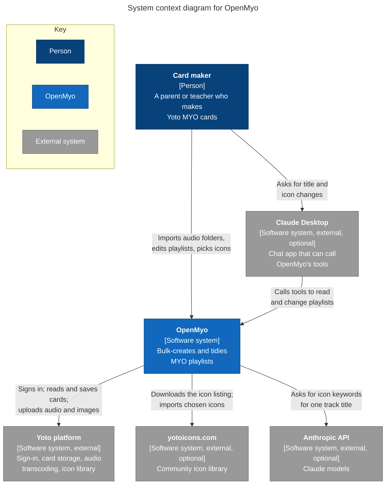
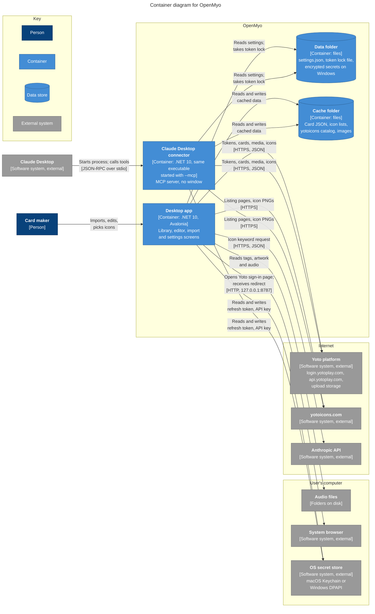

# Architecture overview

This article gives you the bird's-eye view of OpenMyo: what it does, which systems it talks to, and how the executable is split into containers. Read it when you start work in the repo or need to decide where a change belongs.

## Bird's eye view

OpenMyo is a desktop app for macOS and Windows that manages Yoto "Make Your Own" (MYO) playlists. It
turns folders of audio files into playlists on the user's Yoto account, and tidies existing playlists:
titles, track order, covers and the 16×16 pixel icon shown for each track.

OpenMyo has no server and keeps no playlists of its own. Every playlist lives on Yoto as a JSON document
called a **card**. OpenMyo reads cards, changes them, and saves them back through Yoto's public API. Local
files are settings and caches only.

Most of the interesting logic is local and offline: grouping and ordering files, cleaning titles, and
matching each title to an icon with trigram similarity. Claude is an optional extra in two places: the
user can ask Claude for icon keywords in the icon picker, and Claude Desktop can drive OpenMyo through
the Model Context Protocol (MCP).

## System context



## Containers



The desktop app and the connector are the same executable ([`Program`](../../../src/OpenMyo.App/Program.cs)
chooses the mode from the `--mcp` argument) and build the same services. They can run at the same time.
They never talk to each other directly; they share the secret store, the data and cache folders, and a
lock file that stops both refreshing the Yoto token at once.

All communication is request and response. The one slow step is on Yoto's side: after an upload, Yoto
transcodes the audio in the background and OpenMyo polls until it is done.

## Projects

The solution is layered. `OpenMyo.Core` holds the domain and the algorithms; every other project either
implements a Core interface or uses Core.

```text
App ──► Core, Yoto, Claude, Mcp, Infrastructure
Yoto, Claude, Mcp, Infrastructure ──► Core
Core ──► nothing in the solution
```

Folders are organised by feature, not by type, and a feature keeps the same folder name in every project
that has it. The App groups its folders by screen instead.

| Project | Owns |
|---|---|
| [`OpenMyo.Core`](../../../src/OpenMyo.Core) | Domain records, the interfaces other projects implement, import, icon matching and other pure logic |
| [`OpenMyo.Yoto`](../../../src/OpenMyo.Yoto) | Everything that talks to Yoto and yotoicons.com: sign-in, HTTP pipeline, cards, media, icons, player control |
| [`OpenMyo.Claude`](../../../src/OpenMyo.Claude) | The Anthropic API calls and their prompts |
| [`OpenMyo.Mcp`](../../../src/OpenMyo.Mcp) | The Claude Desktop connector's MCP server and tools |
| [`OpenMyo.Infrastructure`](../../../src/OpenMyo.Infrastructure) | Local-machine implementations: audio, secret stores, settings, paths, feeds |
| [`OpenMyo.App`](../../../src/OpenMyo.App) | The Avalonia UI and the composition root; see its [README](../../../src/OpenMyo.App/README.md) |

[`tests/`](../../../tests) has one project per library, mirroring its folders.
[`tools/OpenMyo.Snapshots`](../../../tools/OpenMyo.Snapshots) renders screens to PNG with sample data.

For the data and cache folder locations, see [Data locations](../../user/reference/data-locations.md).

## Related content

- [Invariants](invariants.md)
- [Cross-cutting concerns](cross-cutting-concerns.md)
- [Design decisions](../reference/design-decisions.md)
- [Glossary](../reference/glossary.md)
