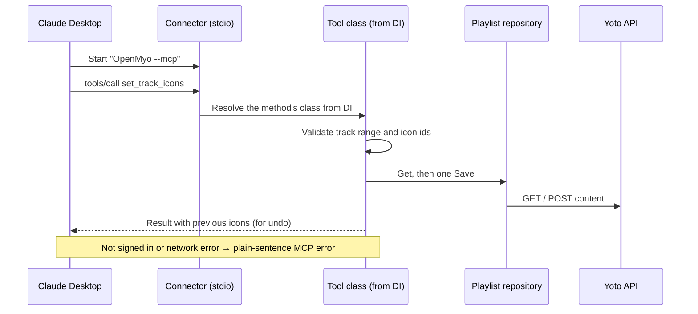

# Claude Desktop connector

Settings → Claude Desktop writes an entry into Claude Desktop's config that launches this same executable
with `--mcp`. Claude Desktop then starts OpenMyo as a background process and talks to it over stdin/stdout.
See [App start-up and composition](app-startup.md) for how connector mode boots.

## How it works

- [`McpEntry`](../../../src/OpenMyo.Mcp/McpEntry.cs) creates the server with fixed instructions describing the
  intended workflow.
- The registry finds every `[McpServerTool]` method in the assembly and resolves its class from DI on each
  call, so tools use the same singletons as the app. The tools live in `src/OpenMyo.Mcp/`.
- Tools that write **validate everything first** (track range, icon ids), then save once. They return the
  previous titles or icons so Claude can undo.
- A guard turns "not signed in" and network errors into plain MCP errors instead of stack traces.
- Sign-in is shared with the app through the secret store, and refreshes are coordinated across processes
  (see [Sign-in and tokens](sign-in-and-tokens.md)). The connector never opens a browser: if there is no
  session, tools say "open OpenMyo and sign in".

## Related content

- [Add a Claude Desktop tool](../how-to/add-claude-desktop-tool.md)
- [Sign-in and tokens](sign-in-and-tokens.md)
- [Use OpenMyo with Claude Desktop](../../user/use-with-claude-desktop.md)
