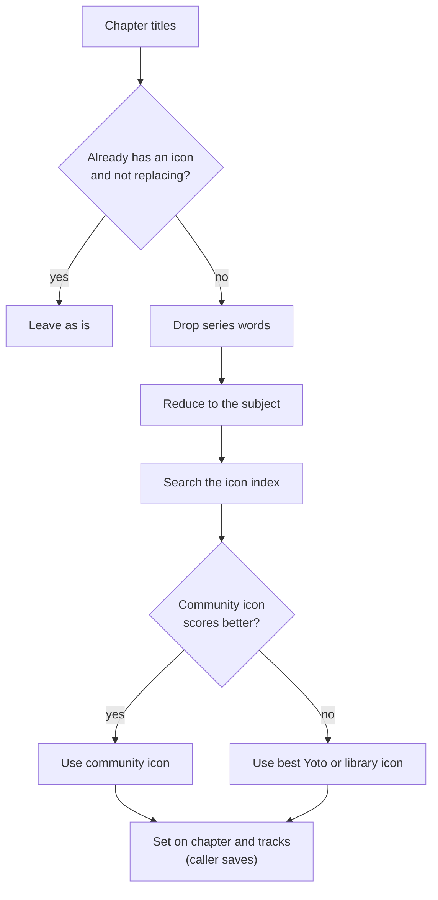

# Icon matching

Given a track title such as *"It Began with a Rabbit's Foot"*, OpenMyo finds the best 16×16 icon among
thousands, for free, offline and deterministically. Read this when icon results look wrong or matching
changes. Claude is an optional extra (see [AI icon search](ai-icon-search.md)).

## Turn text into words

[`TextNormalizer.Keywords`](../../../src/OpenMyo.Core/Text/TextNormalizer.cs) is used on **both** sides (icon
titles and tags, and queries), so they compare like for like: lower-case, accents stripped, punctuation
removed, stop words dropped, and plurals singularised (`foxes` → `fox`).

Two word lists in `src/OpenMyo.Core/Text/` tune matching. Both are embedded text files you can edit without
touching code:

- `WeakWords.txt`: words that rarely describe a picture (verbs, filler, `little`, `bonus`). They still
  count, but at a fraction of a normal word's weight.
- `Synonyms.txt`: `head: related, words`, so a title can match an icon tagged with a related word.

## Trigram similarity

`Trigrams` works like PostgreSQL's `pg_trgm`. A word is padded and cut into overlapping three-character
windows, and similarity is shared ÷ total distinct (Jaccard):

```text
star  → "  s" " st" "sta" "tar" "ar "              (5)
start → "  s" " st" "sta" "tar" "art" "rt "        (6)
shared 4, total distinct 7  →  similarity 0.57
```

This tolerates plurals, typos and word forms without a dictionary.

## The index and the score

[`IconIndex`](../../../src/OpenMyo.Core/Icons/IconIndex.cs) is built once from a list of icons. Each icon gets
terms: its title words at full weight and tag words slightly lower (tags are broader). An inverted index
maps each trigram to the icons that have it, so a search only scores icons sharing at least one trigram
with the query (or a synonym), not the whole catalog.

[`IconScorer`](../../../src/OpenMyo.Core/Icons/IconScorer.cs) scores one icon against the query words:

1. For each query word, take its **best** similarity against the icon's terms: exact word beats synonym
   beats trigram similarity, scaled by the term weight.
2. A weak best counts as 0, so `star` vs `start` counts but random overlaps do not.
3. The score is the **weighted average** over query words (weak words weigh less).

So icons that match *more* of the subject words win, and filler words barely move the score. Ties are
broken by the shorter icon title.

## Where the indexed icons come from

[`IconIndexProvider`](../../../src/OpenMyo.Core/Icons/IconIndexProvider.cs) builds the shared index from:

- **Yoto's public icons** plus the user's own uploads, via `IIconCatalog`;
- **library icons**: every icon already used in the user's playlists. Many are not in the public catalog,
  so the titles of the chapters they were used on become their tags. Searching `connie` then finds the icon
  already used for Connie episodes.

When both know an icon, the catalog entry wins (its tags are curated). The index is rebuilt lazily after
`Invalidate()`, which is called whenever an icon is uploaded, and after each library load.

## From titles to assigned icons

### Import suggestions

[`IconSuggester`](../../../src/OpenMyo.Core/Icons/IconSuggester.cs) searches each title as-is for a handful of
candidates. A track whose best score is weak is "unsure". If the request opted into AI (the import screen
does not), only the unsure titles go to Claude, and its keywords' matches rank ahead of the title's. A track
with no matches at all falls back to matches for the playlist title.

### Auto-match in the editor and MCP

[`IconAutoAssigner`](../../../src/OpenMyo.Core/Icons/IconAutoAssigner.cs):

1. Skips chapters that already have an icon, unless "replace existing" is on.
2. Finds **series words**: words in at least half of the titles. They name the show, not the episode, so
   they are ignored.
3. Reduces each title to its subject: strips numbering, bracketed asides, `Part 2`, a leading `Bonus!`,
   weak words and series words. `It Began with a Rabbit's Foot` → `Rabbit's Foot`.
4. Runs `IconSuggester` on those queries.
5. Asks the community fallback (see [Community icons](community-icons.md)) for any title where yotoicons.com
   scores better than Yoto's best.
6. Sets the winner on each chapter and its tracks. Nothing is saved; the caller saves.



### Number icons

Track *n* can get an icon showing *n*. Yoto's own number icon is used when it exists; otherwise a 16×16 PNG
is drawn and uploaded with a recognisable title, so later runs find it in the user's icons instead of
uploading again. The code is in `src/OpenMyo.Core/Icons/` (`NumberIconMaker`).

## Related content

- [AI icon search](ai-icon-search.md)
- [Community icons](community-icons.md)
- [Improve icon matches](../how-to/improve-icon-matches.md)
- [Match icons](../../user/match-icons.md)
