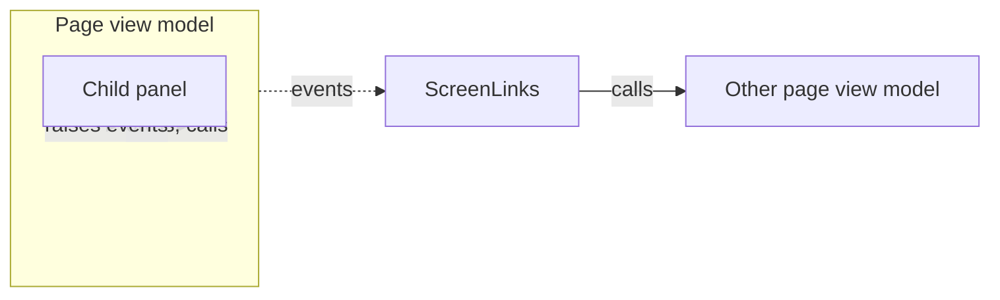

# Navigation and commands

## Navigation

The window is a narrow navigation rail and a content area. Rail entries are `SidebarItem`s held by
[`MainViewModel`](../../../src/OpenMyo.App/Screens/Shell/MainViewModel.cs) in two lists: top items (Library,
Import) and bottom items (Settings). Selecting one calls `MainViewModel.Navigate`, which sets `CurrentPage`
to a page view model. The main window shows `CurrentPage` in a `ContentControl`, and its `DataTemplates`
choose the view for each view model type. Page view models are singletons, so a page keeps its state when
the user navigates away and back.

Panels inside a page, such as the title clean-up panel or the icon picker, are child view models exposed as
properties of the page view model and embedded in the page view with `DataContext="{Binding …}"`. For steps,
see [Add a page to the navigation rail](../how-to/add-navigation-page.md) and
[Add a panel to an existing screen](../how-to/add-panel.md).

## How view models talk to each other

- **Parent → child:** a parent owns its children (constructor or property) and calls them directly.
- **Child → parent:** a child raises an event about itself (`IconChosen`, `RowsDeleted`); it never holds its
  parent. Where a child needs the parent's services, it gets a small interface (`IChapterEditor`,
  `IReorderableOwner`), not the parent type.
- **Page → page:** never directly.
  [`ScreenLinks`](../../../src/OpenMyo.App/Composition/ScreenLinks.cs) subscribes to page events and calls
  the other page, so every cross-page link is in one file.

## Commands

Every button and menu item runs a command on a view model: the view binds `Command="{Binding …}"`, and the
view model declares the method with `[RelayCommand]`. How the pieces fit:

1. **The name is generated.** `[RelayCommand]` on `RematchAllIconsAsync` makes a `RematchAllIconsCommand`
   property at compile time: the generator drops `Async` and adds `Command`. The class must be `partial`.
   Press F12 on the name to see the generated code.
2. **Async commands block double runs.** A method that returns `Task` becomes an `IAsyncRelayCommand`,
   which reports `CanExecute = false` while it runs, so the control greys out until the work finishes.
3. **`CanExecute` drives enabled state.** Save and Revert use `[RelayCommand(CanExecute = nameof(IsDirty))]`;
   `[NotifyCanExecuteChangedFor]` on the backing field re-checks them when it changes.
4. **Command groups keep view models small.** The editor exposes `Icons`, `Batch` and `Cleanup` as
   properties, and the view binds through them (`Icons.…`, `Batch.…`). They live in
   [`Screens/Editor/Commands/`](../../../src/OpenMyo.App/Screens/Editor/Commands).

## Commands versus Click handlers

| | `Click` handler | Command |
|---|---|---|
| Lives in | View code-behind | View model |
| Enabled state | Set `IsEnabled` by hand | From `CanExecute`, and while an async command runs |
| Reuse | One control | Button, menu item and `KeyBinding` share one command |
| Testing | Needs a UI | Call `Execute` on the view model |

`Click` and other events stay in code-behind only for view-only work (focus, drag-and-drop plumbing,
opening a picker), per [CODESTANDARDS](../../../CODESTANDARDS.md) §8. References:
[Avalonia commanding](https://docs.avaloniaui.net/docs/input-interaction/commanding),
[MVVM Toolkit source generators](https://learn.microsoft.com/dotnet/communitytoolkit/mvvm/generators/overview).

## Related content

- [App start-up and composition](app-startup.md)
- [Library and editor](library-and-editor.md)
- [Add a page to the navigation rail](../how-to/add-navigation-page.md)
