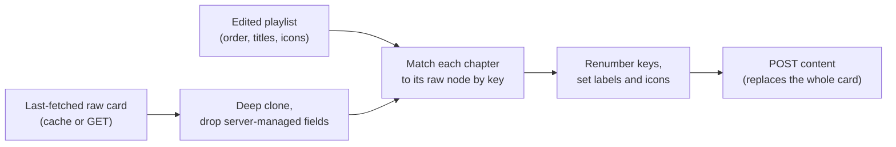

# Read and save cards

[`YotoPlaylistRepository`](../../../src/OpenMyo.Yoto/Content/YotoPlaylistRepository.cs) implements
`IPlaylistRepository` against Yoto's `/content` API.

| Call | Request | Then |
|---|---|---|
| `ListAsync` | `GET content/mine` | One summary per card; cards with invalid ids are dropped |
| `GetAsync(summary)` | `GET content/{id}`, unless the cache has it | Raw JSON mapped to a playlist |
| `SaveAsync` | `POST content` | Response stored in the cache, mapped back |
| `DeleteAsync` | `DELETE content/{id}` | Removed from the cache |

## Caching by updatedAt

The card cache keeps the last raw JSON of every card, in memory and on disk. `GetAsync` reuses it only when
its `updatedAt` equals the one in the fresh listing, so an unchanged library loads with one request. Disk
failures are ignored, since the cache is only an optimisation. See
[Cross-cutting concerns](../architecture/cross-cutting-concerns.md#caching).

## Saving without losing data

Because saving replaces the whole card, rebuilding JSON from the domain model would delete every field
OpenMyo does not model (and Yoto adds fields over time). So a save *patches* the last-fetched document
instead. [`CardComposer`](../../../src/OpenMyo.Yoto/Content/CardComposer.cs) is the entry point:

1. `SaveAsync` takes the cached raw card (or fetches it) as the base.
2. The composer deep-clones it, removes server-managed fields (`createdAt`, `updatedAt`, `_id`, `userId`),
   checks title lengths, and sets the title, cover URL and totals.
3. It rebuilds `content.chapters` in the domain order:
   - Each domain chapter **clones the raw chapter with the same `key`**, so unknown fields carry over.
     Each raw item is used at most once. New chapters start empty.
   - Keys are then **renumbered** (`01`, `02`, …) and the chapter `overlayLabel` set to the position. This is
     how reordering works: the domain keeps the old key so the right raw node is found, and the save writes
     the new position.
   - Tracks follow the same rules, except that a track's `overlayLabel` counts tracks across the whole card
     while its key restarts at `01` in each chapter. Media fields (`format`, `duration`, `fileSize`,
     `channels`) are only written when the track is new or its `trackUrl` changed, so Yoto's own values are
     kept otherwise.
   - Icons are written as `display.icon16x16 = "yoto:#<id>"` only for a valid media id; otherwise the field
     is removed.

## Reading

Reading is the mirror: the mapper never mutates the document. A chapter without its own icon inherits the
first track icon it finds.

## Related content

- [Card model](card-model.md)
- [Library and editor](library-and-editor.md)
- [Add a card field](../how-to/add-card-field.md)
- [Design invariants](../architecture/invariants.md)
