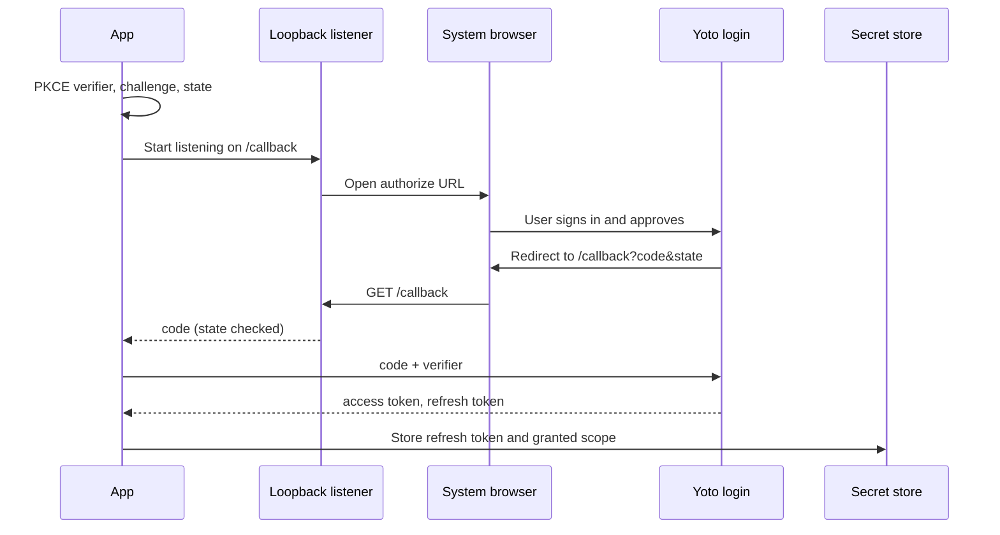

# Sign-in and tokens

## Sign-in flow

Each user registers their own public OAuth client at yoto.dev and pastes its id into Settings. There is no
client secret. Sign-in is Authorization Code + PKCE with a loopback redirect:

The listener ignores requests whose `state` does not match and gives up after a timeout. The loopback
redirect URI is fixed, because the user must register it with their OAuth client.

## Token ownership

[`YotoSession`](../../../src/OpenMyo.Yoto/Auth/YotoSession.cs) owns the tokens afterwards:

- The **access token** lives only in memory. It is refreshed shortly before expiry, or when a request gets
  a 401.
- The **refresh token** lives in the secret store. **Yoto refresh tokens are single-use:** each refresh
  returns a new one, and the old one stops working. Two refreshes with the same token sign the user out.
  So every refresh is serialised twice:
  - within the process by a `SemaphoreSlim`;
  - across processes (the app and the Claude Desktop connector can run at once) by
    [`RefreshLock`](../../../src/OpenMyo.Yoto/Auth/RefreshLock.cs), an exclusively opened file in the data
    folder. The OS releases it if a process dies.

  The refresh token is read *inside* both locks, because the other process may have just replaced it.
- `RefreshAccessTokenAsync(rejectedToken)` only refreshes if the current token is still the rejected one.
  So ten requests that all get a 401 cause one refresh, not ten.
- A 400/401/403 from the token endpoint clears the session (the user must sign in again).
- `TryRestoreAsync` also compares the stored scope with the current scope list. If the app now asks for
  more scopes, the old token is dropped, because refreshing cannot widen a grant.

## Related content

- [Yoto HTTP pipeline](yoto-http-pipeline.md)
- [App start-up and composition](app-startup.md)
- [Claude Desktop connector](claude-desktop-connector.md)
- [Cross-cutting concerns](../architecture/cross-cutting-concerns.md)
