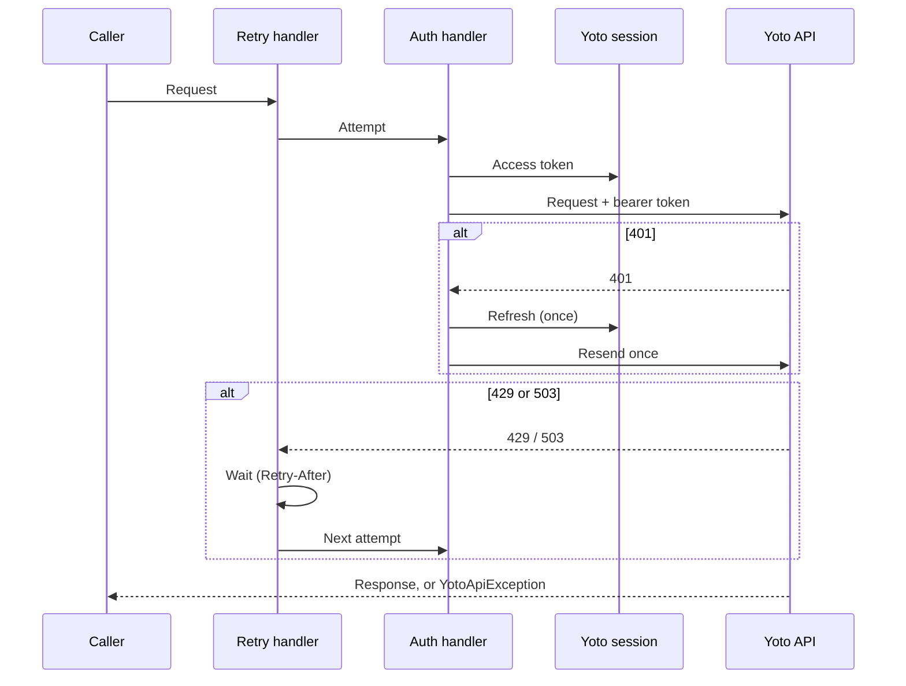

# Yoto HTTP pipeline

[`AddYoto`](../../../src/OpenMyo.Yoto/ServiceCollectionExtensions.cs) registers three named clients:

| Client | Handlers | Used for |
|---|---|---|
| `yoto-api` | retry, then auth | Every API call |
| `yoto-auth` | none | Token exchange and refresh |
| `yoto-upload` | none, no timeout | `PUT` of audio bytes to presigned storage URLs |

## Handlers

A request on `yoto-api` goes through the handlers in order:

1. The retry handler retries **429 and 503** a few times, honouring `Retry-After`.
2. The auth handler adds `Authorization: Bearer …`. On a **401** it asks the session for a new token once and
   resends once.

Both only resend when the body can be sent again. The upload client deliberately has no auth handler, so the
bearer token never reaches the storage host. Non-success responses become `YotoApiException`.

## Related content

- [Sign-in and tokens](sign-in-and-tokens.md)
- [Read and save cards](read-and-save-cards.md)
- [Upload media](media-uploads.md)
- [Add a Yoto endpoint call](../how-to/call-yoto-endpoint.md)
