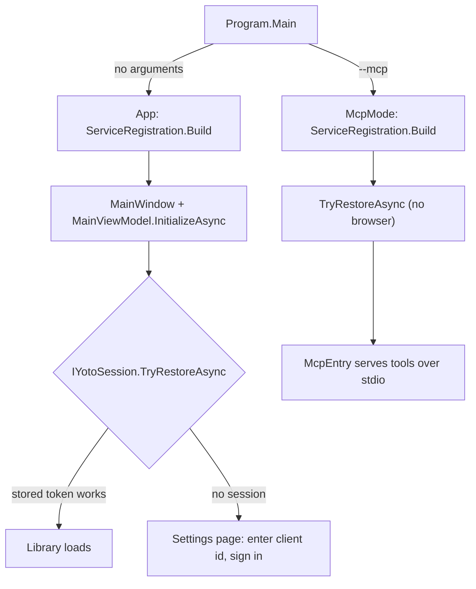
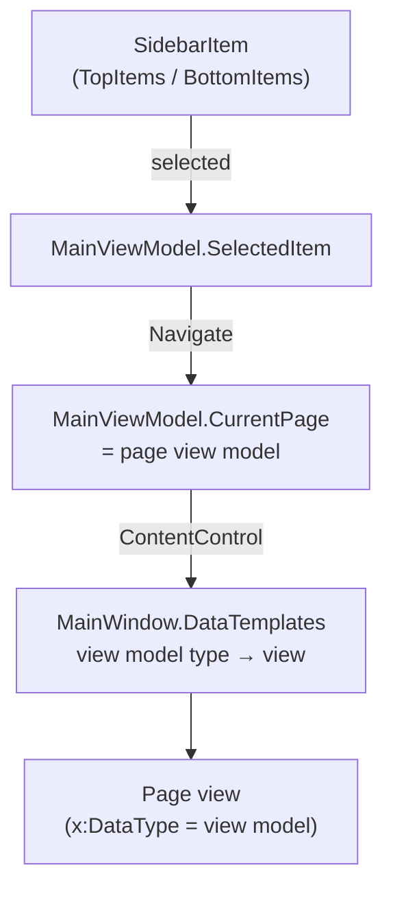
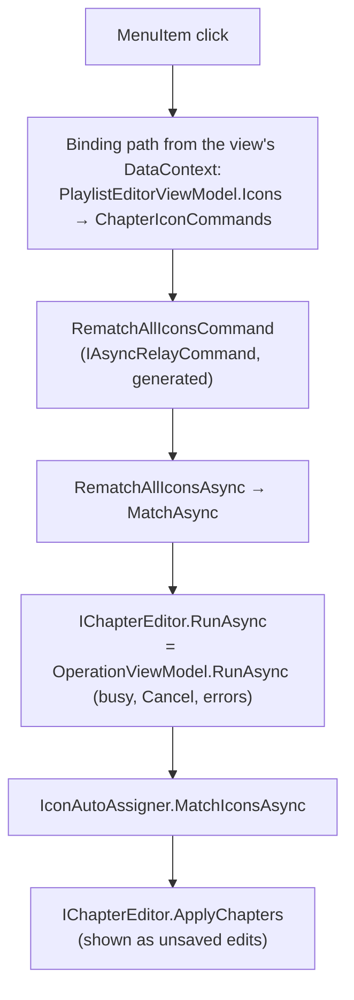
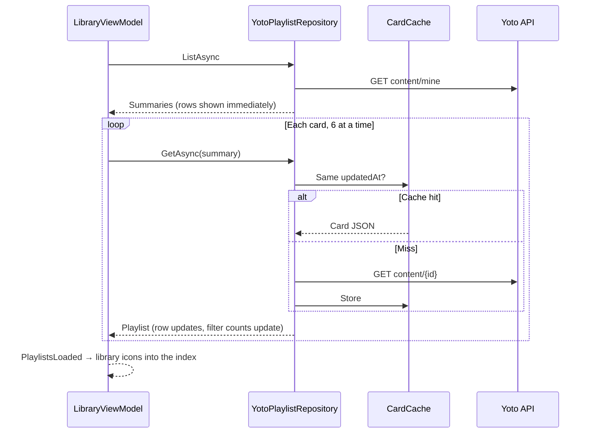
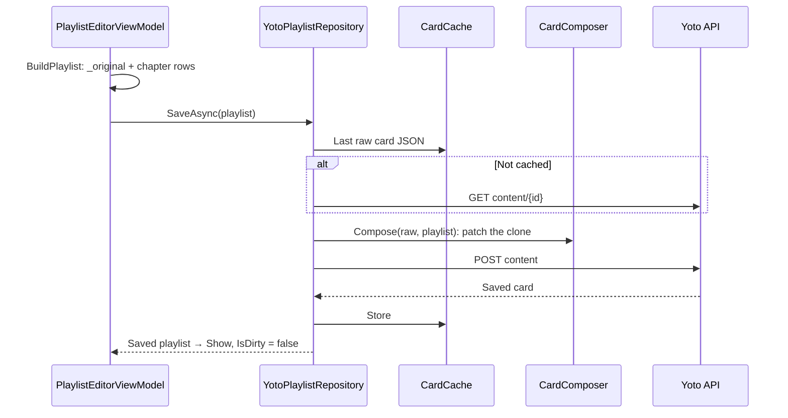
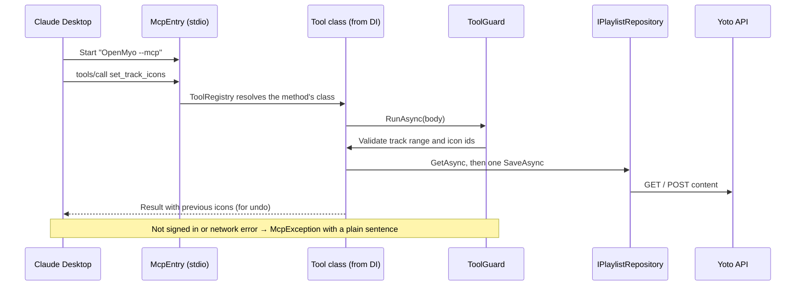

# The desktop app and the Claude Desktop connector

`OpenMyo.App` hosts both: the Avalonia window, and the windowless MCP connector that Claude Desktop starts.
Both build the same services, so a feature in Core is available to the screens and the tools alike.

## Start-up and composition

[`Program.Main`](../../src/OpenMyo.App/Program.cs) picks one of two modes:

- **Window mode** (normal): starts Avalonia. [`App`](../../src/OpenMyo.App/App.axaml.cs) builds the service
  provider and shows [`MainWindow`](../../src/OpenMyo.App/Screens/Shell/MainWindow.axaml) bound to
  [`MainViewModel`](../../src/OpenMyo.App/Screens/Shell/MainViewModel.cs).
- **Connector mode** (`--mcp`): [`McpMode`](../../src/OpenMyo.App/Composition/McpMode.cs) builds the *same*
  services, silently restores the Yoto session, and serves MCP over stdio. Avalonia never starts, and
  nothing else may write to stdout. See [Claude Desktop connector](#claude-desktop-connector).




[`ServiceRegistration.Build`](../../src/OpenMyo.App/Composition/ServiceRegistration.cs) is the composition root.
It calls each project's `AddXxx()` ([Infrastructure](../../src/OpenMyo.Infrastructure/ServiceCollectionExtensions.cs),
[Yoto](../../src/OpenMyo.Yoto/ServiceCollectionExtensions.cs), [Claude](../../src/OpenMyo.Claude/ServiceCollectionExtensions.cs),
[Core](../../src/OpenMyo.Core/ServiceCollectionExtensions.cs), [Mcp](../../src/OpenMyo.Mcp/ServiceCollectionExtensions.cs))
and registers the view models. Two details:

- Almost everything is a **singleton**. The caches and shared in-flight loads only work
  because there is one instance per process.
- Every `HttpClient` gets a `User-Agent`, because Yoto's media CDN returns 403 without one.

**What happens at launch.** `MainViewModel.InitializeAsync` loads settings, then calls
[`IYotoSession.TryRestoreAsync`](../../src/OpenMyo.Core/Abstractions/IYotoSession.cs). If a stored refresh token still works, the sign-in state changes:
the shell opens the library and [`ScreenLinks`](../../src/OpenMyo.App/Composition/ScreenLinks.cs) loads it (see [Loading the library](#loading-the-library)). If not, the app opens on Settings so the user can enter a client id and sign in.

**How the UI handles work and errors.** Every screen view model derives from
[`OperationViewModel`](../../src/OpenMyo.App/Screens/OperationViewModel.cs). Its `RunAsync(status, work)`
sets `IsBusy`, gives the work a `CancellationToken` wired to the Cancel button, and catches *all*
exceptions, showing the message in `Error`. This is the one deliberate catch-all in the codebase:
services below it throw, and the UI boundary reports.

## Navigation

The window is a narrow navigation rail (icons, titles as tooltips) and a content area. Rail entries are [`SidebarItem`](../../src/OpenMyo.App/Screens/Shell/SidebarItem.cs)s held by [`MainViewModel`](../../src/OpenMyo.App/Screens/Shell/MainViewModel.cs)
in two lists, `TopItems` (Library, Import) and `BottomItems` (Settings, pinned to the bottom). Selecting
one calls `MainViewModel.Navigate`, which sets `CurrentPage` to a page view model. [`MainWindow`](../../src/OpenMyo.App/Screens/Shell/MainWindow.axaml) shows
`CurrentPage` in a `ContentControl`, and its `Window.DataTemplates` choose the view for each view model
type. Page view models are singletons, so a page keeps its state when the user navigates away and back.




Panels inside a page, such as the title clean-up panel or the icon picker, are child view models exposed
as properties of the page view model and embedded in the page view with `DataContext="{Binding …}"`.
Steps: [How to add a page to the navigation rail](../how-to.md#how-to-add-a-page-to-the-navigation-rail) and
[How to add a panel to an existing screen](../how-to.md#how-to-add-a-panel-to-an-existing-screen).

## Commands

Every button and menu item runs a command on a view model. The editor's **Re-pick Every Icon** menu item
shows the whole path:

```xml
<!-- Screens/Editor/PlaylistEditorView.axaml (x:DataType="vm:PlaylistEditorViewModel") -->
<MenuItem Header="Re-pick Every Icon" Command="{Binding Icons.RematchAllIconsCommand}" />
```

```csharp
// Screens/Editor/Commands/ChapterIconCommands.cs
[RelayCommand]
private Task RematchAllIconsAsync() => MatchIconsAsync(replaceExisting: true, useAi: false);
```



How the pieces fit:

1. **The name is generated.** `[RelayCommand]` on `RematchAllIconsAsync` makes a `RematchAllIconsCommand`
   property at compile time: the generator drops `Async` and adds `Command`. The class must be `partial`.
   Press F12 on the name to see the generated code.
2. **Async commands block double runs.** A method that returns `Task` becomes an `IAsyncRelayCommand`,
   which reports `CanExecute = false` while it runs, so the control greys out until the work finishes.
3. **`CanExecute` drives enabled state.** Save and Revert use `[RelayCommand(CanExecute = nameof(IsDirty))]`;
   `[NotifyCanExecuteChangedFor]` on `_isDirty` re-checks them when it changes.
4. **Command groups keep view models small.** The editor exposes `Icons` ([`ChapterIconCommands`](../../src/OpenMyo.App/Screens/Editor/Commands/ChapterIconCommands.cs)),
   `Batch` and `Cleanup` as properties, and the view binds through them (`Icons.…`, `Batch.…`).

Why commands and not `Click` handlers:

| | `Click` handler | Command |
|---|---|---|
| Lives in | View code-behind | View model |
| Enabled state | Set `IsEnabled` by hand | From `CanExecute`, and while an async command runs |
| Reuse | One control | Button, menu item and `KeyBinding` share one command |
| Testing | Needs a UI | Call `Execute` on the view model |

`Click` and other events stay in code-behind only for view-only work (focus, drag-and-drop plumbing,
opening a picker), per CODESTANDARDS §8. References:
[Avalonia commanding](https://docs.avaloniaui.net/docs/input-interaction/commanding),
[events vs commands](https://docs.avaloniaui.net/docs/basics/user-interface/adding-interactivity),
[MVVM Toolkit source generators](https://learn.microsoft.com/dotnet/communitytoolkit/mvvm/generators/overview).

## Loading the library



[`LibraryViewModel.RefreshAsync`](../../src/OpenMyo.App/Screens/Library/LibraryViewModel.cs) shows rows as
soon as the listing returns, then loads details in parallel and reports each result back to the UI thread through `Progress<T>`.
Each [`PlaylistRowViewModel`](../../src/OpenMyo.App/Screens/Library/PlaylistRowViewModel.cs) gets its
[`PlaylistIssues`](../../src/OpenMyo.Core/Library/PlaylistIssues.cs) from
[`PlaylistHealth`](../../src/OpenMyo.Core/Library/PlaylistHealth.cs): no tracks, any chapter without an icon,
no cover. The filter chips above the list ([`FilterChipViewModel`](../../src/OpenMyo.App/Screens/Library/FilterChipViewModel.cs)) are just these flags:
"All" clears the filter, problem chips toggle and combine, and a row shows when it has every chosen issue
([`LibraryFilter.Matches`](../../src/OpenMyo.Core/Library/LibraryFilter.cs)). Each chip counts its own matches; problem chips at 0 fade out.
When every card is loaded, [`ScreenLinks`](../../src/OpenMyo.App/Composition/ScreenLinks.cs) feeds [`LibraryIcons.FromPlaylists`](../../src/OpenMyo.Core/Icons/LibraryIcons.cs) into [`IconIndexProvider`](../../src/OpenMyo.Core/Icons/IconIndexProvider.cs) (see [Where the indexed icons come from](icon-matching.md#where-the-indexed-icons-come-from)).

Selecting several rows enables [`BulkActionsViewModel`](../../src/OpenMyo.App/Screens/Library/BulkActionsViewModel.cs)
(match missing icons across every selected playlist, and delete with a two-click confirm). The library
hands it `SelectedRows` and listens for its `RowsUpdated` and `RowsDeleted` events; it never holds the library.

## Editing a playlist

Selecting one row opens [`PlaylistEditorViewModel`](../../src/OpenMyo.App/Screens/Editor/PlaylistEditorViewModel.cs).
It keeps the loaded [`Playlist`](../../src/OpenMyo.Core/Playlists/Playlist.cs) as `_original` and shows its chapters as editable
[`ChapterRowViewModel`](../../src/OpenMyo.App/Screens/Editor/ChapterRowViewModel.cs)s. Any change (rename,
drag-reorder via [`DragReorder`](../../src/OpenMyo.App/Controls/DragReorder.cs), icon, delete) sets `IsDirty`.

- **Save** rebuilds a `Playlist` from `_original` plus the rows (each row keeps its original chapter key),
  calls `SaveAsync`, and shows the saved result. The Yoto client turns that into a patch of the raw card (see [Reading and saving cards](yoto-client.md#reading-and-saving-cards)).



- **Revert** shows `_original` again.
- **Add tracks** and **Change cover** upload first and then save immediately through
  [`PlaylistMediaService`](../../src/OpenMyo.Core/Publishing/PlaylistMediaService.cs).

The editor's command groups live beside it in [`Screens/Editor`](../../src/OpenMyo.App/Screens/Editor):
[`ChapterIconCommands`](../../src/OpenMyo.App/Screens/Editor/Commands/ChapterIconCommands.cs) (auto-match, number,
open picker), [`ChapterBatchCommands`](../../src/OpenMyo.App/Screens/Editor/Commands/ChapterBatchCommands.cs)
(multi-select edits), [`TitleCleanupViewModel`](../../src/OpenMyo.App/Screens/Editor/TitleCleanupViewModel.cs)
(the rules in [Titles](import.md#titles) with a preview), and [`TrackSuggestionsViewModel`](../../src/OpenMyo.App/Screens/Editor/TrackSuggestionsViewModel.cs).
They reach the editor only through [`IChapterEditor`](../../src/OpenMyo.App/Screens/Editor/Commands/IChapterEditor.cs)
(run work, read the current playlist, apply changed chapters), which keeps the editor file small.
The icon picker is hidden until the user clicks a track's icon (`PickIconCommand`; `ClosePickerCommand` or Escape
hides it again). It also shows while it asks for an API key an AI action needs (`ShowPicker`).
[`ChapterSelection`](../../src/OpenMyo.App/Screens/Editor/ChapterSelection.cs) knows nothing about the picker: while it
is open, the editor points it at `Selection.Target` and, after each pick, calls `SelectNextWithoutIcon`
([`IconTargetSequence`](../../src/OpenMyo.App/Screens/IconPicker/IconTargetSequence.cs), shared with Import).

## Images

[`RemoteImageCache`](../../src/OpenMyo.App/Services/RemoteImageCache.cs) downloads each icon and cover URL once,
keeping bytes on disk and decoded bitmaps in memory. Concurrent requests for one URL share a download.
[`IconBitmapLoader`](../../src/OpenMyo.App/Services/IconBitmapLoader.cs) resolves a media id or
[`ArtworkSource`](../../src/OpenMyo.Core/Import/ArtworkSource.cs) to a bitmap. [`PixelImage`](../../src/OpenMyo.App/Controls/PixelImage.cs) draws 16×16 icons
scaled up without blurring.

## Claude Desktop connector

Settings → Claude Desktop ([`ClaudeDesktopViewModel`](../../src/OpenMyo.App/Screens/Settings/ClaudeDesktopViewModel.cs))
writes an entry into Claude Desktop's config ([`ClaudeDesktopConfigFile`](../../src/OpenMyo.Infrastructure/ClaudeDesktop/ClaudeDesktopConfigFile.cs),
[`ConnectorConfigJson`](../../src/OpenMyo.Core/ClaudeDesktop/ConnectorConfigJson.cs)) that launches this same
executable with `--mcp`. Claude Desktop then starts OpenMyo as a background process and talks to it over
stdin/stdout.




- [`McpEntry`](../../src/OpenMyo.Mcp/McpEntry.cs) creates the server with fixed instructions describing the
  intended workflow.
- [`ToolRegistry`](../../src/OpenMyo.Mcp/Support/ToolRegistry.cs) finds every `[McpServerTool]` method in the
  assembly and resolves its class from DI on each call, so tools use the same singletons as the app.
- Tools: [`PlaylistTools`](../../src/OpenMyo.Mcp/Playlists/PlaylistTools.cs) (list, get),
  [`PlaylistEditTools`](../../src/OpenMyo.Mcp/Playlists/PlaylistEditTools.cs) (rename playlist),
  [`TrackEditTools`](../../src/OpenMyo.Mcp/Playlists/TrackEditTools.cs) (rename),
  [`IconSearchTools`](../../src/OpenMyo.Mcp/Icons/IconSearchTools.cs) (search),
  [`IconEditTools`](../../src/OpenMyo.Mcp/Icons/IconEditTools.cs) (set),
  [`IconAutomationTools`](../../src/OpenMyo.Mcp/Icons/IconAutomationTools.cs) (auto-match, number).
- Tools that write **validate everything first** (track range, icon ids via
  [`IconResolver`](../../src/OpenMyo.Mcp/Icons/IconResolver.cs)), then save once. They return the previous
  titles or icons so Claude can undo.
- [`ToolGuard`](../../src/OpenMyo.Mcp/Support/ToolGuard.cs) turns "not signed in" and network errors into
  plain MCP errors instead of stack traces.
- Sign-in is shared with the app through the secret store, and refreshes are coordinated by [`RefreshLock`](../../src/OpenMyo.Yoto/Auth/RefreshLock.cs)
  (see [Sign-in and tokens](yoto-client.md#sign-in-and-tokens)). The connector never opens a browser: if there is no session, tools say "open OpenMyo and sign in".

## Other platforms

Avalonia can also target iOS, Android and the browser (WebAssembly), but OpenMyo builds only the desktop
head: [`Program`](../../src/OpenMyo.App/Program.cs) calls `UsePlatformDetect()` and
`StartWithClassicDesktopLifetime`, and the App project references `Avalonia.Desktop` only.

Views, view models, commands and bindings would carry over unchanged. Each new platform needs its own
small entry-point project, and the shared UI would move out of `OpenMyo.App` into a library those
projects reference. Building for iOS needs a Mac. Core, Yoto and Claude are plain `net10.0` libraries.

These parts assume a desktop and would need a replacement or would be left out:

| Part | Desktop assumption | Web (WebAssembly) | iOS |
|---|---|---|---|
| Sign-in ([`LoopbackAuthorizer`](../../src/OpenMyo.Yoto/Auth/LoopbackAuthorizer.cs)) | Listens on `http://127.0.0.1:8787/callback` | No listener; redirect to the page itself | Use the system auth session with an app redirect URI |
| Secrets ([`SecretStoreFactory`](../../src/OpenMyo.Infrastructure/Secrets/SecretStoreFactory.cs)) | macOS Keychain or Windows DPAPI | No secure store in the browser | iOS Keychain |
| Import ([`IFilePickerService`](../../src/OpenMyo.App/Services/IFilePickerService.cs), [`TagLibAudioMetadataReader`](../../src/OpenMyo.Infrastructure/Audio/TagLibAudioMetadataReader.cs)) | Folder picker returning local paths | Picked files arrive as streams; no folders | Files app picks; sandboxed paths |
| Data and cache folders ([`AppPaths`](../../src/OpenMyo.Infrastructure/Paths/AppPaths.cs)) | Application Support / LocalAppData | Browser storage only | App sandbox folders |
| Claude Desktop connector (`--mcp`) | A second process on stdio | Not possible | Not possible |
| Calls to Yoto, yotoicons.com and Anthropic | Direct HTTPS | Only if each service allows cross-origin requests (not checked) | Direct HTTPS |
| Keyboard shortcuts, hover, drag-reorder | Mouse and keyboard | Works | Needs touch alternatives |

References: [Avalonia supported platforms](https://docs.avaloniaui.net/docs/supported-platforms),
[dealing with platforms](https://docs.avaloniaui.net/docs/guides/building-cross-platform-applications/dealing-with-platforms).
