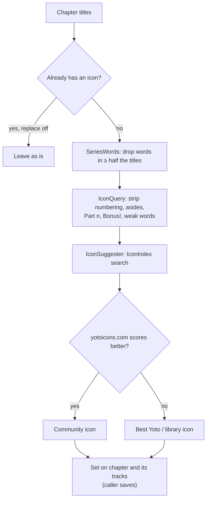

# Icon matching

The goal: given a track title such as *"It Began with a Rabbit's Foot"*, find the best 16×16 icon among
thousands, for free, offline, deterministically. Claude is an optional extra (see [Search with AI](#search-with-ai)).

## Turning text into words

[`TextNormalizer.Keywords`](../../src/OpenMyo.Core/Text/TextNormalizer.cs) is used on **both** sides (icon
titles and tags, and queries), so they compare like for like:

- lower-case, accents stripped, anything that is not a letter or digit becomes a space;
- stop words dropped (`the`, `of`, `track`, `chapter`, `episode` …), as are single characters and pure numbers;
- plurals singularised (`stars` → `star`, `foxes` → `fox`, `berries` → `berry`).

Two word lists in Core tune matching. Both are embedded text files you can edit without touching code:

- [`WeakWords.txt`](../../src/OpenMyo.Core/Text/WeakWords.txt): words that rarely describe a picture (verbs,
  filler, `little`, `bonus`). They still count, at weight **0.25** instead of 1.
- [`Synonyms.txt`](../../src/OpenMyo.Core/Text/Synonyms.txt): `head: related, words`, e.g.
  `trivia: question, quiz, brain, bulb`, so a title can match an icon tagged with a related word.

## Trigram similarity

[`Trigrams`](../../src/OpenMyo.Core/Text/Trigrams.cs) works like PostgreSQL's `pg_trgm`. A word is padded as
`"  word "` and cut into overlapping three-character windows. Similarity is shared ÷ total distinct (Jaccard):

```text
star  → "  s" " st" "sta" "tar" "ar "              (5)
start → "  s" " st" "sta" "tar" "art" "rt "        (6)
shared 4, total distinct 7  →  similarity 0.57
```

This tolerates plurals, typos and word forms without a dictionary. Trigrams are packed into `long`s and
kept sorted, so comparing two words is one linear merge.

## The index and the score

[`IconIndex`](../../src/OpenMyo.Core/Icons/IconIndex.cs) is built once from a list of
[`DisplayIcon`](../../src/OpenMyo.Core/Icons/DisplayIcon.cs)s:

- Each icon gets terms ([`IconTerm`](../../src/OpenMyo.Core/Icons/IconTerm.cs)): its title words at weight
  1.0 and tag words at 0.9 (tags are broader).
- An inverted index maps each trigram to the icons that have it. A search only scores icons sharing at
  least one trigram with the query (or a synonym), not the whole catalog.

[`IconScorer`](../../src/OpenMyo.Core/Icons/IconScorer.cs) scores one icon against the query words:

1. For each query word, take its **best** similarity against the icon's terms:
   exact word = 1.0, synonym = 0.8, else the trigram similarity; times the term weight.
2. A best below **0.4** counts as 0, so `star` vs `start` (0.57) counts but random overlaps do not.
3. The score is the **weighted average** over query words (weak words weigh 0.25).

So icons that match *more* of the subject words win, and filler words barely move the score.
Example: for `Twinkle Twinkle Little Star` against an icon titled `Star` with no tags, the words are
`twinkle` (1), `little` (0.25, weak) and `star` (1). Only `star` matches, so the score is
(0 + 0 + 1) ÷ 2.25 ≈ 0.44. Ties are broken by the shorter icon title.

`IconIndex` also exposes `Vocabulary` (the 1,500 most common icon words, used in the Claude prompt) and
`Number(n)` (Yoto's own icon for a digit, see [From titles to assigned icons](#from-titles-to-assigned-icons)).

## Where the indexed icons come from

[`IconIndexProvider`](../../src/OpenMyo.Core/Icons/IconIndexProvider.cs) builds the shared index from:

- [`IIconCatalog`](../../src/OpenMyo.Core/Abstractions/IIconCatalog.cs): Yoto's public icons (cached on disk for 7 days, stale copy used when offline) plus the
  user's own uploads (memory only) ([`YotoIconCatalog`](../../src/OpenMyo.Yoto/Icons/YotoIconCatalog.cs));
- **library icons** ([`LibraryIcons`](../../src/OpenMyo.Core/Icons/LibraryIcons.cs)): every icon already used
  in the user's playlists. Many are not in the public catalog, so the titles of the chapters they were used
  on become their tags. Searching `connie` then finds the icon already used for Connie episodes.

When both know an icon, the catalog entry wins (its tags are curated). The index is rebuilt lazily after
`Invalidate()`, which is called whenever an icon is uploaded, and after each library load.

## From titles to assigned icons

Three entry points use the index:

**Import suggestions** ([`IconSuggester`](../../src/OpenMyo.Core/Icons/IconSuggester.cs)): each title is
searched as-is for up to 12 candidates. A track whose best score is under **0.75** is "unsure". If the
request opted into AI (the import screen does not), only the unsure titles go to Claude, and its keywords'
matches rank ahead of the title's. A track with no matches at all falls back to matches for the playlist
title.

**Auto-match in the editor and MCP** ([`IconAutoAssigner`](../../src/OpenMyo.Core/Icons/IconAutoAssigner.cs)):

1. Skips chapters that already have an icon, unless "replace existing" is on.
2. Finds **series words** ([`SeriesWords`](../../src/OpenMyo.Core/Text/SeriesWords.cs)): words in at least half
   of the titles (with 4 or more titles). They name the show, not the episode, so they are ignored.
3. Reduces each title to its subject ([`IconQuery`](../../src/OpenMyo.Core/Text/IconQuery.cs)): strips
   numbering, bracketed asides, `Part 2`, a leading `Bonus!`, weak words and series words.
   `It Began with a Rabbit's Foot` → `Rabbit's Foot`.
4. Runs `IconSuggester` on those queries.
5. Asks the community fallback (see [Community icons](#community-icons-yotoiconscom)) for any title where yotoicons.com scores better than Yoto's best.
6. Sets the winner on each chapter and its tracks. Nothing is saved; the caller saves.




**Number icons** ([`NumberIconMaker`](../../src/OpenMyo.Core/Icons/NumberIconMaker.cs)): track *n* gets
an icon showing *n*. Yoto's own number icon is used when it exists ([`NumberIcons`](../../src/OpenMyo.Core/Icons/NumberIcons.cs));
otherwise [`NumberIconPainter`](../../src/OpenMyo.Core/Icons/NumberIconPainter.cs) draws a 16×16 PNG
([`PngWriter`](../../src/OpenMyo.Core/Icons/PngWriter.cs)) and uploads it with a recognisable title, so later
runs find it in the user's icons instead of uploading again. Supports 1–999.

## Search with AI

Claude never sees icon ids and never chooses an icon. It only suggests 1–3 *drawable keywords* for a title,
which are then matched locally like any other search.

- [`AiIconSearch`](../../src/OpenMyo.Core/Icons/AiIconSearch.cs) runs only when the user clicks the button in
  the [icon picker](../../src/OpenMyo.App/Screens/IconPicker/IconPickerViewModel.cs) and caches answers per title
  for the session.
- [`ClaudeKeywordGenerator`](../../src/OpenMyo.Claude/ClaudeKeywordGenerator.cs) sends the title plus the
  index vocabulary ([`KeywordPrompt`](../../src/OpenMyo.Claude/KeywordPrompt.cs)), so Claude picks words that
  actually exist on icons. The system prompt is prompt-cached, effort is `low`, output is constrained to a
  JSON schema and parsed by [`KeywordResponse`](../../src/OpenMyo.Claude/KeywordResponse.cs), and `max_tokens`
  is 1,024 + 48 per title.
- The model comes from Settings (default `claude-opus-5-5`). The API key comes from [`ISecretStore`](../../src/OpenMyo.Core/Abstractions/ISecretStore.cs).
- If there is no key, or the call fails, matching carries on with trigrams only.

## Community icons (yotoicons.com)

yotoicons.com is a free community site with many more icons than Yoto's catalog. To keep searches local
and the load on the site low, OpenMyo downloads its whole listing once and searches it offline:

- [`CommunityCatalogHarvester`](../../src/OpenMyo.Core/CommunityIcons/CommunityCatalogHarvester.cs) reads
  page 1 to learn the total, then all other pages **4 at a time**, retrying each twice. Pages that still fail
  are skipped and the catalog is marked incomplete. Pages are parsed by
  [`YotoIconsListingParser`](../../src/OpenMyo.Core/CommunityIcons/YotoIconsListingParser.cs).
- [`CommunityCatalogProvider`](../../src/OpenMyo.Core/CommunityIcons/CommunityCatalogProvider.cs) loads the
  saved catalog when it is under 7 days old, otherwise harvests. All callers share one in-flight load.
  An incomplete catalog is used but harvested again on the next launch.
- [`CommunityCatalogIndex`](../../src/OpenMyo.Core/CommunityIcons/CommunityCatalogIndex.cs) reuses
  [`IconIndex`](../../src/OpenMyo.Core/Icons/IconIndex.cs), and for automatic matching multiplies the score by *focus* (how much of the icon's own
  wording the title matched). A focused `fence` icon beats a song-lyric icon that happens to contain "fence".
  Ties go to the most downloaded icon.
- [`CommunityIconFallback`](../../src/OpenMyo.Core/Icons/CommunityIconFallback.cs) uses a community icon only
  when it scores at least **0.15** and beats Yoto's best for that title by 0.01 (ties go to Yoto, since its
  icons need no upload). If the site is unreachable, it returns nothing rather than failing.
- [`CommunityIconImporter`](../../src/OpenMyo.Core/CommunityIcons/CommunityIconImporter.cs) downloads the
  chosen PNG and uploads it as the user's own icon, at most once per icon per run.
