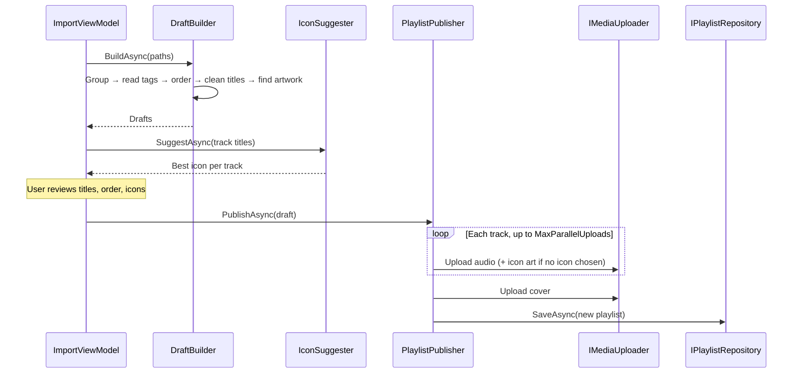

# Bulk import

The user drops folders or files on [`ImportViewModel`](../../src/OpenMyo.App/Screens/Import/ImportViewModel.cs).
[`DraftBuilder`](../../src/OpenMyo.Core/Import/DraftBuilder.cs) turns them into
[`PlaylistDraft`](../../src/OpenMyo.Core/Import/PlaylistDraft.cs)s with no network access. Then the import
screen asks for icon suggestions, the user reviews, and [`PlaylistPublisher`](../../src/OpenMyo.Core/Publishing/PlaylistPublisher.cs)
uploads and creates each playlist.

## Importing from a podcast feed

The **From Feed…** dialog ([`FeedImportViewModel`](../../src/OpenMyo.App/Screens/Import/Feed/FeedImportViewModel.cs)) previews before anything downloads:

1. [`FeedUrl`](../../src/OpenMyo.Core/Feeds/FeedUrl.cs) accepts http(s) links, `feed://`/`itpc://` subscribe links and bare
   addresses. A link pasted anywhere on the import screen opens the dialog with it.
2. [`FeedParser`](../../src/OpenMyo.Core/Feeds/FeedParser.cs) reads RSS 2.0 with the iTunes extensions. Only items with an audio
   enclosure count. Episodes are put oldest first, by `pubDate` when every item has one, otherwise in
   reverse feed order. DTDs and external entities are never resolved.
3. The user ticks episodes (latest 100 ticked; more than 100 can't be downloaded) and can narrow the list with
   [`EpisodeFilter`](../../src/OpenMyo.Core/Feeds/EpisodeFilter.cs): a minimum and maximum length (episodes with no
   length in the feed pass), words to exclude and words a title must contain. Filtered-out episodes are hidden
   and unticked. One [`EpisodeOrder`](../../src/OpenMyo.Core/Feeds/EpisodeOrder.cs) toggle sets both the list order
   and the track order on the card (oldest first by default).
4. [`FeedImporter`](../../src/OpenMyo.Core/Feeds/FeedImporter.cs) downloads them in parallel (the **Feed episodes downloaded at the same time** setting, `AppSettings.MaxParallelDownloads`, default 6, at most 8; each row in the preview shows its own progress) into
   `<cache>/FeedDownloads/<id>/001.mp3 …`, and the show artwork as `cover.<type>` (type sniffed from the bytes;
   a broken image link only loses the cover). It builds the draft directly, not through `DraftBuilder`: the
   feed's order and titles are more reliable than podcast tags. Titles still go through `TitleCleaner`, the
   show title becomes the playlist title and its artwork the cover.
5. The draft joins the import screen like any other. Its folder is deleted when the draft is published,
   discarded or cleared; anything left behind (a crash, the app closed) is swept after two days on the next
   feed download.

## Which files become which playlist

[`ImportGrouper`](../../src/OpenMyo.Core/Import/ImportGrouper.cs):

- Dropped folders are expanded recursively to audio files ([`MediaTypes`](../../src/OpenMyo.Core/Import/MediaTypes.cs));
  hidden files are skipped.
- **Every folder that directly holds audio becomes one playlist.**
- **Disc folders merge into their parent.** A folder named like `CD1`, `Disc 2` or `disk_03` belongs to the
  folder above it, so a two-CD audiobook becomes one playlist.

## Track order

[`TrackOrderer`](../../src/OpenMyo.Core/Import/TrackOrderer.cs) sorts by disc first (disc tag, else the `CD 2`
folder number, else 1). Within a disc it uses the most trustworthy signal that **every** file has:

1. Track-number tags, but only if all files have one and no two clash on the same disc.
2. Otherwise, a leading number in every file name (`01 …`, `Track 3`, `2-05 …`).
3. Otherwise, natural file-name order ([`NaturalStringComparer`](../../src/OpenMyo.Core/Text/NaturalStringComparer.cs),
   so `2` sorts before `10`).

"All or nothing" matters: mixing tagged and untagged files would interleave them.

## Titles

[`DraftBuilder`](../../src/OpenMyo.Core/Import/DraftBuilder.cs) picks the raw title for each track: the tag title, unless it is empty or a placeholder like
`Track 01`, in which case the file name. The playlist title is the album tag if every track agrees on it,
otherwise the folder name.

[`TitleCleaner.CleanAll`](../../src/OpenMyo.Core/Text/TitleCleaner.cs) then cleans the whole list together.
Each rule can be switched off in [`TitleCleanupOptions`](../../src/OpenMyo.Core/Text/TitleCleanupOptions.cs)
(the editor's clean-up panel exposes them). In order:

| Rule | Example |
|---|---|
| Separators: `_`, `%20`, and dots when there are no spaces; web addresses removed | `my.song.name` → `my song name` |
| Noise in brackets: `(Official Audio)`, `(Lyrics)`, `[320 kbps]`, `(Remastered)` … | |
| Anything in `[square brackets]` (download ids) | `Song [x7Gh2]` → `Song` |
| Numbering: `CD1 `, `1-03 `, `03 - `, `Track 3.` | |
| Bare leading number: always if zero-padded (`01 Song`), otherwise only when **every** title starts with a digit | keeps `99 Red Balloons` in a normal list |
| ALL CAPS or all lower case → Title Case (only when more than 3 letters) | |
| User find/replace | |
| A shared `Artist - ` prefix on every title is removed | |

If cleaning leaves nothing, the raw title is kept. Results are cut to 140 characters.
`TitleCleanupOptions.SuitedTo` turns off the bracket rule when at least 80% of titles start with `[`,
because then `[051] Connie` is the user's own numbering, not junk.

## Artwork

[`ArtworkLocator`](../../src/OpenMyo.Core/Import/ArtworkLocator.cs) returns
[`ArtworkSource`](../../src/OpenMyo.Core/Import/ArtworkSource.cs)s (a file, or "the picture embedded in this
audio file"). Nothing is read until publishing.

- **Cover**: an image named `cover`, `folder`, `front`, `album`, `albumart` or `artwork`; else the only
  image in the folder that is not a track sidecar; else the first embedded picture.
- **Per-track icon art**: an image with the same base name as the audio file (`03 Owl.mp3` + `03 Owl.png`).
  Embedded pictures count only when tracks carry *different* pictures; identical embedded art is the album
  cover, not an icon.

## Publishing

[`PlaylistPublisher`](../../src/OpenMyo.Core/Publishing/PlaylistPublisher.cs):

- Uploads tracks in parallel, `MaxParallelUploads` at a time (setting, clamped to 1–8). Results go into a
  fixed array by index, so parallelism never changes the order.
- For each track, the icon is the chosen one ([`TrackDraft.IconMediaId`](../../src/OpenMyo.Core/Import/TrackDraft.cs)).
  If none was chosen, the icon art from 5.4 is uploaded as a custom icon; if there is none, the track has no icon.
- [`UploadProgressTracker`](../../src/OpenMyo.Core/Publishing/UploadProgressTracker.cs) combines per-file
  progress into one bar.
- Each track becomes one chapter with one track, keys `01`, `02`, … Cover is uploaded, then one `SaveAsync`
  creates the card.
- `AppendAsync` does the same for "Add tracks" in the editor, numbering after the existing chapters.
  [`PlaylistMediaService`](../../src/OpenMyo.Core/Publishing/PlaylistMediaService.cs) runs added files through
  the same [`DraftBuilder`](../../src/OpenMyo.Core/Import/DraftBuilder.cs) so they are cleaned and ordered like an import.
