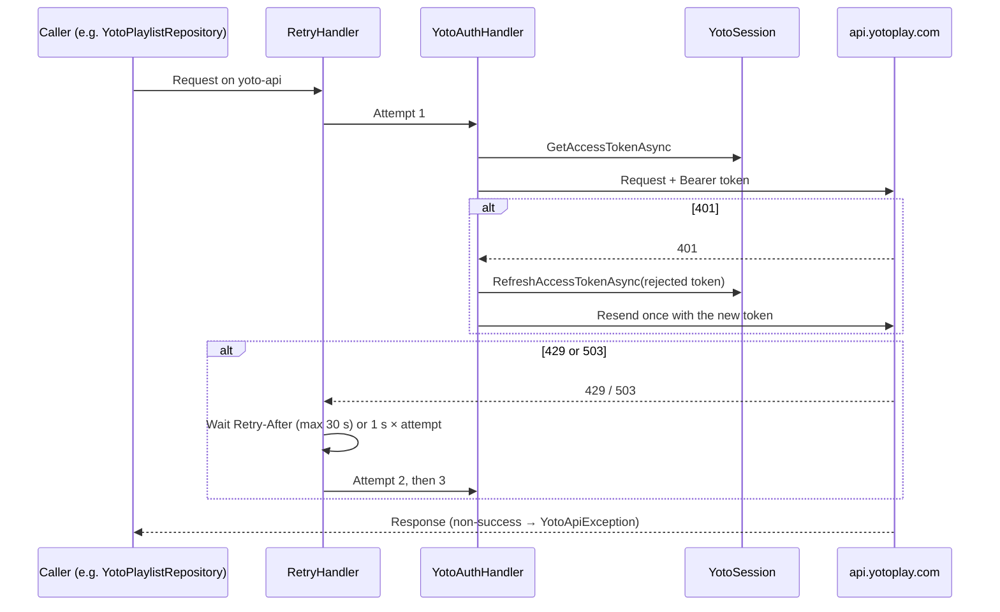
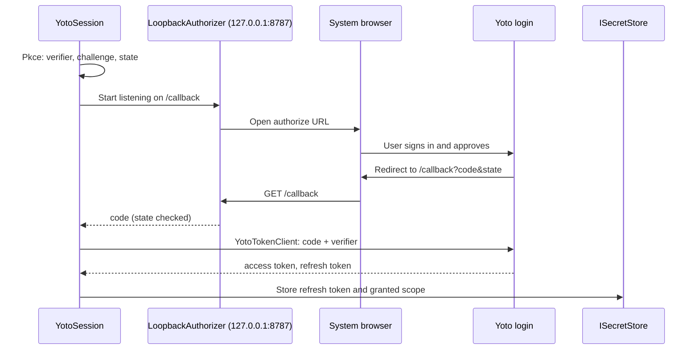
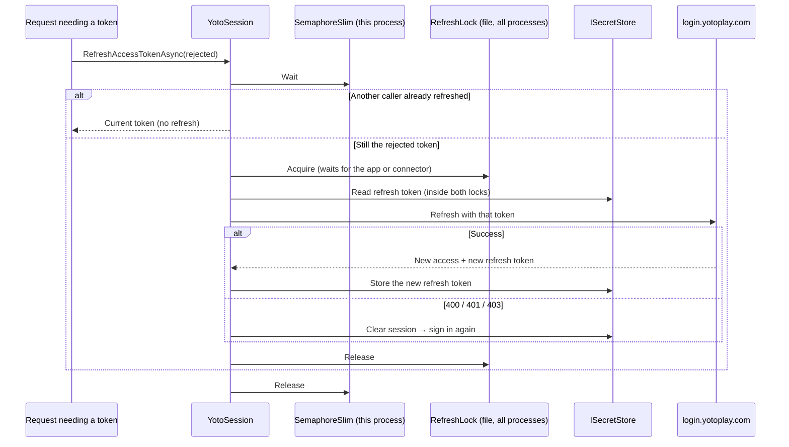
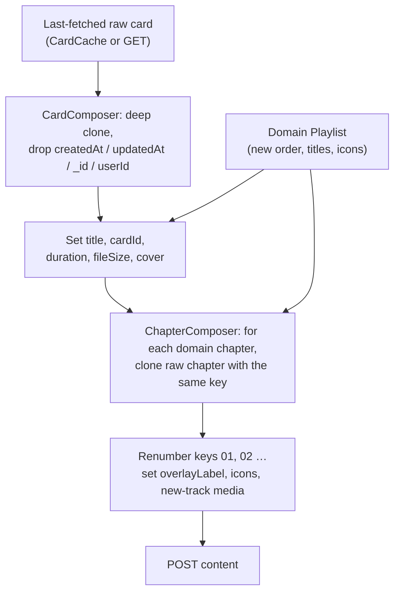
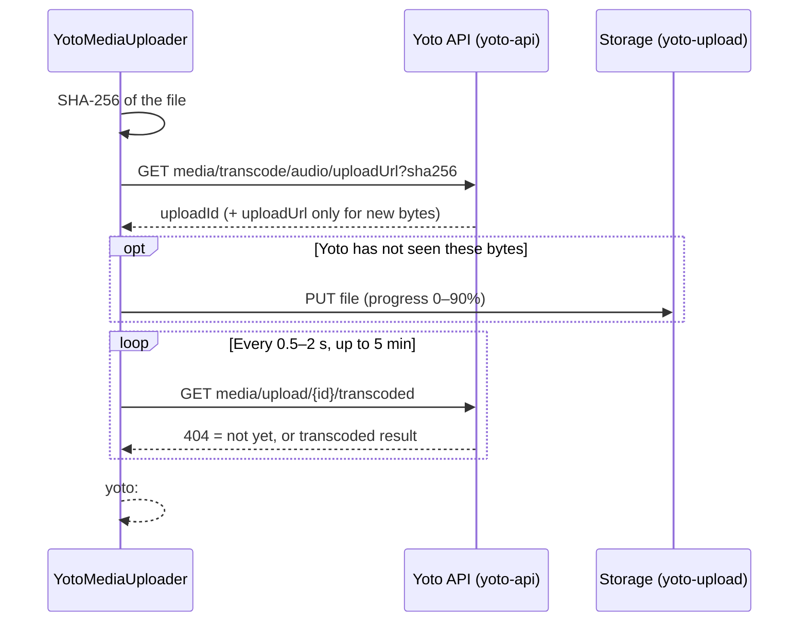

# The Yoto client

`OpenMyo.Yoto` is everything that speaks to Yoto: sign-in, the HTTP pipeline, reading and saving cards,
and uploading audio and images. It implements [`IPlaylistRepository`](../../src/OpenMyo.Core/Abstractions/IPlaylistRepository.cs), [`IMediaUploader`](../../src/OpenMyo.Core/Abstractions/IMediaUploader.cs) and [`IIconCatalog`](../../src/OpenMyo.Core/Abstractions/IIconCatalog.cs)
from Core.

## The card model

Everything OpenMyo does ends up as a change to a **card** on Yoto's `/content` API. A Make Your Own card
is one JSON document:

```text
card
├─ cardId, title, updatedAt, …            (plus fields OpenMyo does not model)
├─ metadata.cover.imageL                   cover image URL
└─ content.chapters[]                      what the player steps through
   ├─ key "01", title, overlayLabel "1"
   ├─ display.icon16x16 "yoto:#<mediaId>"  the 16×16 pixel icon the player shows
   └─ tracks[]
      ├─ key "01", title
      ├─ trackUrl "yoto:#<sha256>"         transcoded audio held by Yoto
      └─ format, duration, fileSize, channels, display.icon16x16
```

Properties of the Yoto model that shape the code:

- **A chapter is what the user sees as "a track".** MYO cards normally have one track per chapter.
  OpenMyo creates exactly that shape, and renaming a single-track chapter renames its track too
  ([`Chapter.WithTitle`](../../src/OpenMyo.Core/Playlists/Chapter.cs)). Setting an icon sets it on the chapter
  *and* each of its tracks ([`IconAutoAssigner.WithIcon`](../../src/OpenMyo.Core/Icons/IconAutoAssigner.cs)).
- **Icons are referenced by media id.** A media id is 43 URL-safe characters. Yoto's public icons and the
  user's own uploads live in the same id space, so assigning an icon is just writing `yoto:#<id>`.
- **Audio is referenced by content hash.** Uploading a file gives back `yoto:#<sha256 of the transcode>`.
- **Saving is whole-document.** `POST /content` with a `cardId` replaces the card. There is no
  per-field PATCH, so OpenMyo saves by patching the last-fetched document (see [Reading and saving cards](#reading-and-saving-cards)).
- **Titles are capped at 140 characters** ([`TitleCleaner.MaxTitleLength`](../../src/OpenMyo.Core/Text/TitleCleaner.cs)).
  Yoto rejects the whole save for one over-long chapter title without saying which.

The domain mirrors this as immutable records: [`Playlist`](../../src/OpenMyo.Core/Playlists/Playlist.cs) →
[`Chapter`](../../src/OpenMyo.Core/Playlists/Chapter.cs) → [`Track`](../../src/OpenMyo.Core/Playlists/Track.cs),
plus [`PlaylistSummary`](../../src/OpenMyo.Core/Playlists/PlaylistSummary.cs) for the cheap library listing.
Every edit produces a new record (`with { … }`); nothing mutates a playlist in place.

## HTTP pipeline

[`AddYoto`](../../src/OpenMyo.Yoto/ServiceCollectionExtensions.cs) registers three named clients
([`YotoHttpClients`](../../src/OpenMyo.Yoto/Http/YotoHttpClients.cs)):

| Client | Base address | Handlers | Used for |
|---|---|---|---|
| `yoto-api` | `api.yotoplay.com` | [`RetryHandler`](../../src/OpenMyo.Yoto/Http/RetryHandler.cs) → [`YotoAuthHandler`](../../src/OpenMyo.Yoto/Auth/YotoAuthHandler.cs) | Every API call |
| `yoto-auth` | `login.yotoplay.com` | none | Token exchange and refresh |
| `yoto-upload` | none (presigned URLs) | none, no timeout | `PUT` of audio bytes to storage |

A request on `yoto-api` goes through the handlers in order:

1. `RetryHandler` retries **429 and 503** up to 3 attempts, waiting for `Retry-After` (capped at 30 s) or
   1 s × attempt.
2. `YotoAuthHandler` adds `Authorization: Bearer …`. On a **401** it asks the session for a new token once
   and resends once.




Both only resend when the body can be sent again ([`RequestContent.CanResend`](../../src/OpenMyo.Yoto/Http/RequestContent.cs)).
The upload client deliberately has no auth handler, so the bearer token never reaches the storage host.
Non-success responses become [`YotoApiException`](../../src/OpenMyo.Yoto/Http/YotoApiException.cs) via
[`YotoResponse`](../../src/OpenMyo.Yoto/Http/YotoResponse.cs).

## Sign-in and tokens

Each user registers their own public OAuth client at yoto.dev and pastes its id into Settings. There is no
client secret. Sign-in is Authorization Code + PKCE with a loopback redirect:



[`LoopbackAuthorizer`](../../src/OpenMyo.Yoto/Auth/LoopbackAuthorizer.cs) ignores requests whose `state`
does not match ([`AuthorizationCallback`](../../src/OpenMyo.Yoto/Auth/AuthorizationCallback.cs)) and gives up
after 5 minutes. [`Pkce`](../../src/OpenMyo.Yoto/Auth/Pkce.cs) makes the verifier, challenge and state;
[`YotoAuthEndpoints`](../../src/OpenMyo.Yoto/Auth/YotoAuthEndpoints.cs) holds the URLs and scope list.

[`YotoSession`](../../src/OpenMyo.Yoto/Auth/YotoSession.cs) owns the tokens afterwards:

- The **access token** lives only in memory. It is refreshed when it is within 60 s of expiry, or when a
  request gets a 401.
- The **refresh token** lives in [`ISecretStore`](../../src/OpenMyo.Core/Abstractions/ISecretStore.cs). **Yoto refresh tokens are single-use:** each refresh
  returns a new one, and the old one stops working. Two refreshes with the same token sign the user out.
  So every refresh is serialised twice:
  - within the process by a `SemaphoreSlim`;
  - across processes (the app and the Claude Desktop connector can run at once) by
    [`RefreshLock`](../../src/OpenMyo.Yoto/Auth/RefreshLock.cs), an exclusively opened file in the data
    folder. The OS releases it if a process dies.

  The refresh token is read *inside* both locks, because the other process may have just replaced it.
- `RefreshAccessTokenAsync(rejectedToken)` only refreshes if the current token is still the rejected one.
  So ten requests that all get a 401 cause one refresh, not ten.



- A 400/401/403 from the token endpoint clears the session (the user must sign in again).
- `TryRestoreAsync` also compares the stored scope with the current scope list. If the app now asks for
  more scopes, the old token is dropped, because refreshing cannot widen a grant.

## Reading and saving cards

[`YotoPlaylistRepository`](../../src/OpenMyo.Yoto/Content/YotoPlaylistRepository.cs) implements
[`IPlaylistRepository`](../../src/OpenMyo.Core/Abstractions/IPlaylistRepository.cs):

| Call | Request | Then |
|---|---|---|
| `ListAsync` | `GET content/mine` | [`CardMapper.ToSummary`](../../src/OpenMyo.Yoto/Content/CardMapper.cs) per card; cards with invalid ids are dropped |
| `GetAsync(summary)` | `GET content/{id}`, unless the cache has it | Raw JSON → `CardMapper.ToPlaylist` |
| `SaveAsync` | `POST content` | Response stored in the cache, mapped back |
| `DeleteAsync` | `DELETE content/{id}` | Removed from the cache |

**Caching by `updatedAt`.** [`CardCache`](../../src/OpenMyo.Yoto/Content/CardCache.cs) keeps the last raw JSON
of every card, in memory and as `cache/cards/{id}.json`. `GetAsync` reuses it only when its `updatedAt`
equals the one in the fresh listing, so an unchanged library loads with one request. Disk failures are
ignored, since the cache is only an optimisation.

**Saving without losing data.** Because saving replaces the whole card, rebuilding JSON from the domain
model would delete every field OpenMyo does not model (and Yoto adds fields over time). So a save
*patches* the last-fetched document instead:

1. `SaveAsync` takes the cached raw card (or fetches it) as the base.
2. [`CardComposer`](../../src/OpenMyo.Yoto/Content/CardComposer.cs) deep-clones it, removes server-managed
   fields (`createdAt`, `updatedAt`, `_id`, `userId`), checks title lengths, sets `title`, `cardId`,
   `metadata.media.duration/fileSize` and the cover URL.
3. [`ChapterComposer`](../../src/OpenMyo.Yoto/Content/ChapterComposer.cs) rebuilds `content.chapters` in the
   domain order:
   - Each domain chapter **clones the raw chapter with the same `key`**, so unknown fields carry over.
     Each raw item is used at most once. New chapters start empty.
   - Keys are then **renumbered** (`01`, `02`, …) and the chapter `overlayLabel` set to the position. This is how
     reordering works: the domain keeps the old key so the right raw node is found, and the save writes the
     new position.
   - Tracks follow the same rules, except that a track's `overlayLabel` counts tracks across the whole card
     (1, 2, 3, … as in Yoto's examples) while its key restarts at `01` in each chapter. Media fields (`type`, `format`, `duration`, `fileSize`, `channels`) are
     only written when the track is new or its `trackUrl` changed, so Yoto's own values are kept otherwise.
   - Icons are written as `display.icon16x16 = "yoto:#<id>"` only for a valid media id
     ([`CardIds`](../../src/OpenMyo.Yoto/Content/CardIds.cs)); otherwise the field is removed.




Reading is the mirror: `CardMapper` never mutates the document. A chapter without its own icon inherits
the first track icon it finds.

## Uploading media

[`YotoMediaUploader`](../../src/OpenMyo.Yoto/Media/YotoMediaUploader.cs):

**Audio** (`UploadAudioAsync`):

1. Hash the file with SHA-256.
2. `GET media/transcode/audio/uploadUrl?sha256=…`. Yoto returns an upload id and, *only if it has never
   seen these bytes*, a presigned upload URL. Re-importing the same file skips the upload entirely.
3. `PUT` the file to the presigned URL on the `yoto-upload` client.
   [`ProgressFileContent`](../../src/OpenMyo.Yoto/Media/ProgressFileContent.cs) reports bytes sent; upload is
   shown as 90% of the progress bar.
4. Poll `media/upload/{id}/transcoded` (404 means "not yet") with backoff from 0.5 s to 2 s, for up to
   5 minutes ([`PollingPolicy`](../../src/OpenMyo.Yoto/Media/PollingPolicy.cs)).
5. Return `yoto:#<transcodedSha256>` with the format, duration, size and channels Yoto reports.




**Cover**: `POST media/coverImage/user/me/upload` returns a public URL that goes in
`metadata.cover.imageL`.

**Icon**: `POST media/displayIcons/user/me/upload?autoConvert=true` (Yoto scales it to 16×16) returns a
media id. The uploader then tells [`YotoIconCatalog`](../../src/OpenMyo.Yoto/Icons/YotoIconCatalog.cs) to forget the user's icon list so the new icon shows
up in searches.
