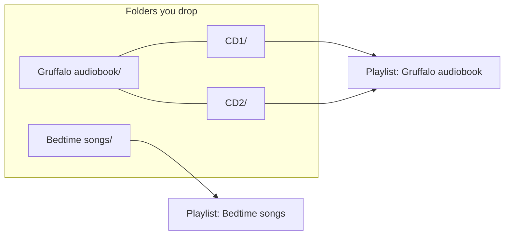

# Import folders of audio as playlists

Use bulk import to turn folders or audio files into Yoto playlists. Each folder becomes one playlist, and OpenMyo cleans titles, orders tracks and finds artwork for you.

## Prerequisites

- You're signed in to Yoto. See [Quickstart: Sign in and run OpenMyo](quickstart.md).

## Import folders

1. Open the **Import** screen.
2. Choose, or drag in, folders or audio files. Each folder becomes a draft playlist.
3. Review each draft. To listen first, hover a track and select ▶. Import previews play your local files before anything is uploaded.
4. Choose **Create Playlists**.

## What OpenMyo does for you

**Titles.** Track numbers, underscores, "(Official Audio)"-style noise and repeated artist prefixes are removed from titles. To change the rules, see [Tidy titles](edit-playlists.md#tidy-titles).

**Order.** Tracks are ordered by disc and track tags, then leading numbers, then name.

**Folders.** Every folder that holds audio becomes one playlist. Disc folders such as `CD1` and `CD2` join the folder above them, so a two-CD audiobook becomes one playlist:

**Cover art.** The cover comes from an image in the folder (`cover.jpg`, `folder.jpg`, and so on) or from art embedded in the audio.

**Track icons.** A track gets an icon from an image with the same base name as its audio file. To match icons from titles instead, see [Match icons to tracks](match-icons.md).

## Related content

- [Import a podcast feed as a playlist](import-podcast-feed.md)
- [Edit a playlist](edit-playlists.md)
- [Play audio on your computer or a Yoto player](play-audio.md)
- [Import pipeline](../contribute/concepts/import-pipeline.md)
